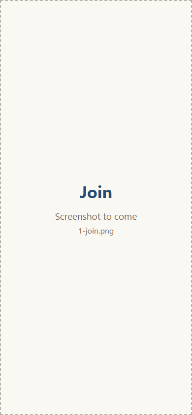
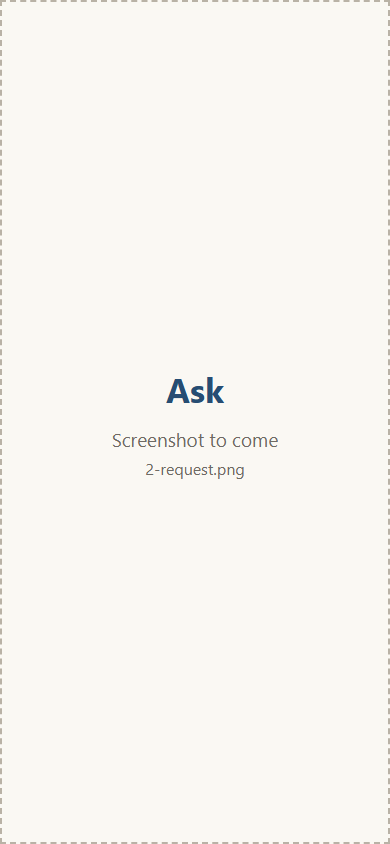
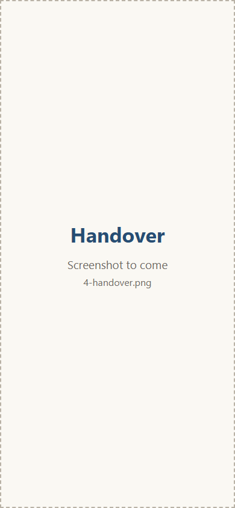
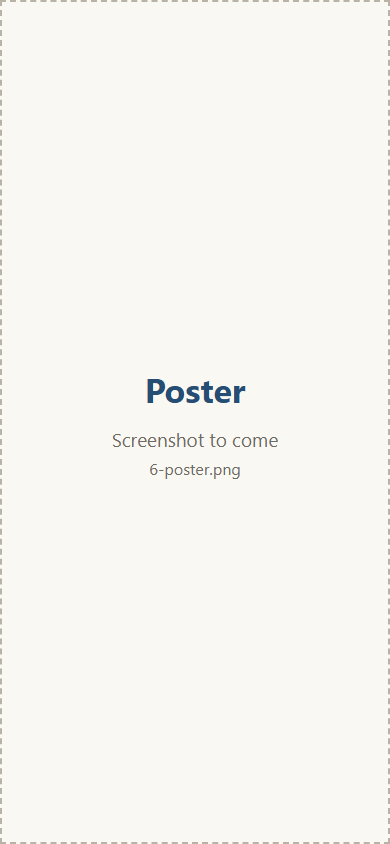

# Otonari (お隣)

**Borrow from next door, in your own language.**


Otonari (お隣, "next door") is an installable web app (PWA) that lets neighbors in the same building or block in Japan lend and borrow things they rarely use, like a futon dryer, a stepladder or a takoyaki maker. Nobody types a message: every message is a fixed phrase that each neighbor reads in their own language (English, Japanese, Easy Japanese or Bengali).

**The connection we update (TSUNAGU: Update the Way We Connect).** Neighbors live a few meters apart but never ask each other for help, because of language, shyness, and 遠慮 (*enryo*): the Japanese reluctance to impose on others, or to chase an overdue item. Otonari repairs this broken link between foreign residents, who need things but can't ask, and elderly residents, who own useful things but rarely talk to their neighbors. Asking takes a few taps, both sides read polite words in their own language, and the app sends the awkward reminder, so nobody has to.

## Features

- **Neighborhood shelf.** Log in, and join with the code on the poster in your building or block. Share items by picking them from a fixed catalog.
- **Borrowing in two languages.** Choose the day, time and length with taps, and see the exact sentence your neighbor will read before you send it. They tap Yes or No. Quick replies ("I'm on my way", "Thank you") cover the rest, and "Show original" proves that both sides saw the same meaning.
- **Handover and return.** A condition photo before and after, side by side.
- **Reminders nobody has to send.** 24 hours before an item is due, and again when it is overdue, Otonari politely reminds the borrower. When it is overdue, the lender is told that this has been taken care of.
- **For elderly neighbors.** Large text and buttons, 🔊 read-aloud on every message, and Easy Japanese (やさしい日本語).
- **Trust.** Every request shows how reliable the borrower has been, and an item can be limited to neighbors who have already returned something on time.
- **QR poster.** A printable A4 poster in Japanese, English and Bengali for the notice board.
- **Start a new neighborhood.** A building manager or neighborhood association leader creates a group and prints its poster.
- **Etiquette tips** at the right moment: before asking, at handover and at return.
- **Installable.** Add it to the home screen like an app; it updates itself. Only the app's own files stay on the phone: loans, messages and photos always come from the server.

## Screenshots

<!-- Placeholders: replace the files in docs/screenshots/ with real screenshots, keeping the file names. -->

| 1. Join | 2. Ask | 3. Answer |
|---|---|---|
|  |  |  |
| Scan the poster, pick a nickname and a language. | The preview shows what your neighbor will read. | The lender reads polite Japanese in large text. |

| 4. Handover | 5. Return | 6. Poster |
|---|---|---|
|  |  |  |
| A condition photo, then "I received it". | Both photos side by side, and a thank-you. | The way into the neighborhood. |

## How to run

Choose one way:

| | Way A: Docker | Way B: Node.js |
|---|---|---|
| **Best for** | Trying the app out | Changing the code |
| **You need** | Git and Docker Desktop | Git, Docker Desktop (for the database) and Node.js 22.18 or newer |
| **Address** | <http://localhost:8088> | <http://localhost:5173> |

Downloads: [Git](https://git-scm.com/downloads), [Docker Desktop](https://www.docker.com/products/docker-desktop/), [Node.js](https://nodejs.org).

### Way A: Docker (easiest)

**Step 1. Start Docker Desktop** and wait until it is running.

**Step 2. Download the project.**

```bash
git clone https://github.com/MdLabib355/otonari.git
cd otonari
```

**Step 3. Start everything.** The first start takes a few minutes. No settings file is needed.

```bash
docker compose up --build
```

**Step 4. Open the app** at <http://localhost:8088> and log in with a [demo account](#demo-accounts).

**Step 5. Stop it** with `Ctrl+C`. The data stays. Next time, start again with step 3.

| Command | What it does |
|---|---|
| `docker compose up --build` | Starts everything, with the newest code. Run it again after every `git pull`. |
| `docker compose up --build -d` | The same, in the background. Stop it with `docker compose down` (the data stays). |
| `docker compose exec server node seed.ts` | Resets the demo data. **Deletes all accounts, items and loans.** |
| `docker compose down -v` | Removes everything. **Deletes the database and the photos too.** |

### Way B: Node.js (for development)

**Step 1. Start Docker Desktop**, then check that Node.js is 22.18 or newer:

```bash
node --version
```

**Step 2. Download and install.** `npm install` also installs the `client` and `server` folders.

```bash
git clone https://github.com/MdLabib355/otonari.git
cd otonari
npm install
```

**Step 3. Create the settings file.** It works without changes.

| Terminal | Command |
|---|---|
| macOS, Linux, Git Bash, PowerShell | `cp server/.env.example server/.env` |
| Windows command prompt | `copy server\.env.example server\.env` |

**Step 4. Start the database** (PostgreSQL in Docker, port 5433).

```bash
npm run db
```

**Step 5. Start the server and the client.** The server fills an empty database with the demo data.

```bash
npm run dev
```

**Step 6. Open the app** at <http://localhost:5173> and log in with a [demo account](#demo-accounts).

**Step 7. Stop it** with `Ctrl+C`. Next time, only steps 4 and 5 are needed.

| Command | What it does |
|---|---|
| `npm run db` | Starts only the database, in Docker. Ways A and B share this database. |
| `npm run dev` | Server (port 3001) and client (port 5173) with automatic reload. |
| `npm run seed` | Resets the demo data. **Deletes all accounts, items, loans and the photos in `server/uploads/`.** |
| `npm run seed:empty` | The same reset, but with only the two groups and nobody in them: for a demo with real people. |
| `npm run typecheck` | Checks the types of client and server. |
| `npm run build` | Builds the client. Run it again after every change. |
| `npm start` | Runs the server with the built client on port 3001. |

**For a demo**, use `npm run build` and then `npm start` instead of `npm run dev`. Open <http://localhost:3001>, or `http://<IP address of this computer>:3001` on a phone in the same Wi-Fi.

### Demo accounts

| Role | Email | Password |
|---|---|---|
| User | `tanaka@otonari.example`, `yamamoto@...`, `maria@...`, `ayesha@...` (Sakura Heights), `kobayashi@...` (Hamaguchi-machi) | `otonari2611` |
| Group admin | `sato@otonari.example` (Sakura Heights), `inoue@otonari.example` (Hamaguchi-machi) | `otonari2611` |
| Super admin | `admin@otonari.example` (only Way A; in Way B, set `SUPER_ADMIN_...`) | `otonari2611` |

- **Registering a new account:** in Way A, the 6-digit code is in the test mailbox at <http://localhost:8089> (unless `server/.env` has a real mail server). In Way B, set `SMTP_...` first.
- **Join codes:** `SAKURA-2611` (Sakura Heights) and `HAMA-3CHOME` (Hamaguchi-machi 3-chome).
- **Two neighbors on one computer:** open the second one in a private window. The 5-step demo script is in [CLAUDE.md](CLAUDE.md), section 10.
- **These passwords are public.** Before others can reach the server, set `DEMO_MODE=false` (in Way A, in `docker-compose.yml`) and your own `SUPER_ADMIN_EMAIL` and `SUPER_ADMIN_PASSWORD`.

### Settings (optional)

All settings are explained in [server/.env.example](server/.env.example). To use one, remove the `# ` in front of it in `server/.env`, enter your value, and start the app again. In Way A, create this file as in Way B, step 3. Never commit `server/.env`: it holds secrets.

| Setting | What it is for | Without it |
|---|---|---|
| `SMTP_...` | Sends the 6-digit codes as real emails | Way A: test mailbox. Way B: no registering by email |
| `GOOGLE_CLIENT_ID` | "Continue with Google" | No Google button |
| `S3_BUCKET`, `AWS_...` | Photos in a private AWS S3 bucket | Photos are stored on this computer |
| `SUPER_ADMIN_...` | The first super admin | Way A: the demo super admin. Way B: none |
| `DEMO_MODE` | `true`: the demo accounts can log in, and an active loan has fast-forward buttons for the reminders | Demo accounts can't log in |

### Install it like an app

Choose "Install app" in the browser's menu ("Add to Home Screen" on an iPhone). Browsers allow this only over HTTPS and on `localhost`, and it doesn't work with `npm run dev`. On an iPhone, install it first and log in inside the installed app, because it doesn't share the login with the browser.

### If something goes wrong

| Problem | What to do |
|---|---|
| `Cannot connect to the Docker daemon`, or an error about `docker_engine` | Start Docker Desktop and wait until it is running. |
| Port 8088 or 8089 is already in use | Create a file named `.env` in the project folder (next to `docker-compose.yml`) with `OTONARI_PORT=9000` or `MAILBOX_PORT=9001`. |
| Port 3001 or 5173 is already in use | Close the other server, for example an older `npm run dev`. |
| The server says "Waiting for the database" | Run `npm run db` again, also after `docker compose up`: only `npm run db` opens port 5433. |
| A change is not visible | Way A: `docker compose up --build`. With `npm start`: `npm run build`, then `npm start` again. |
| Demo accounts can't log in | Check that `DEMO_MODE=true` in `server/.env`. |

## Deploy on Render

Otonari runs on [Render](https://render.com) as one free Web Service (Node). Create it from this repository with these settings:

| Setting | Value |
|---|---|
| Build Command | `npm run render-build` |
| Start Command | `npm start` |
| Environment variables | `NODE_VERSION` = `22`, `DEMO_MODE` = `true`, and `DATABASE_URL` = the internal URL of a Render PostgreSQL database |

The address is HTTPS, so phones can install the app. The free plan sleeps after 15 minutes without visitors, and it loses all photos whenever it restarts. An empty database gets the demo data. With `DEMO_MODE=true` anyone can log in as the demo neighbors, so this is for demos, not for real lending. Set `SUPER_ADMIN_EMAIL` and `SUPER_ADMIN_PASSWORD` there, and `SMTP_...` / `GOOGLE_CLIENT_ID` if you want them.

## Tech stack

- **Client:** React 18, Vite, react-router-dom, TypeScript and plain CSS, `qrcode` for the poster, `vite-plugin-pwa` to make it installable
- **Server:** Node.js (runs the TypeScript files directly), TypeScript, Express, pg, multer for photo uploads, cors, dotenv
- **Database:** PostgreSQL 17; photos in a private AWS S3 bucket, or in `server/uploads/` without one
- **Docker:** docker compose with PostgreSQL, Node and nginx
- **Development:** concurrently, nodemon

No CSS framework or state library: the code is meant to be read and explained by everyone on the team.

## Project structure

```
otonari/
├── shared/types.ts           the types of the API answers, used by both sides
├── client/                   the React app
│   ├── public/               the app icons (drawn by make-icons.ps1)
│   └── src/
│       ├── app/              routes, header, navigation, service worker
│       ├── core/             calls to the server, the logged-in user, unread messages
│       ├── components/       used by several features: ChipGroup, FilterStrip, Icons, SpeakButton, TipCard, TrustLine
│       ├── features/         one folder per feature, like the server: group, user, item, loan, message, demo
│       ├── i18n/             en.json, ja.json, ja-easy.json, bn.json, and index.ts, which renders the phrases
│       ├── data/catalog.ts   the items, handover spots, quick replies and loan lengths to choose from
│       └── styles/           plain CSS, one file per part of the app
├── server/                   the Express API (modular MVC)
│   ├── index.ts              starts the server (and serves the built client)
│   ├── api/v1.ts             version 1 of the API (/api/v1): which routes belong to it
│   ├── core/                 used by all modules: database tables, login check, the only keys the server accepts
│   ├── modules/              one folder per feature, each with its routes, controller, model and view:
│   │   ├── group/  user/  item/  message/  demo/
│   │   └── loan/             also the photos and the polite reminders
│   └── seed.ts               the demo data
├── docs/screenshots/
├── CLAUDE.md                 our specification
└── BUILD_PROMPTS.md          our build steps
```

## How translation works

**No AI, no translation service.** The database never contains a translated sentence. A message is a phrase key and parameters:

```json
{
  "phrase_key": "request",
  "params": {
    "item": "futon_dryer",
    "spot": "entrance",
    "start": "2026-11-24T00:00:00.000Z",
    "end": "2026-11-27T00:00:00.000Z",
    "name": "Rahim"
  }
}
```

Each person's app renders it from that person's language file (`client/src/i18n/`):

| Language | What the neighbor reads |
|---|---|
| English | May I borrow your futon dryer from Tue, Nov 24, 9:00 AM to Fri, Nov 27, 9:00 AM? |
| 日本語 | 11月24日(火) 9:00から11月27日(金) 9:00まで、布団乾燥機をお借りしてもよろしいでしょうか。 |
| やさしい にほんご | ふとんを かわかす きかい を かりたいです。11月24日(火) 9:00 から 11月27日(金) 9:00 まで です。いいですか。 |
| বাংলা | আমি কি মঙ্গল ২৪ নভে, ৯:০০ AM থেকে শুক্র ২৭ নভে, ৯:০০ AM পর্যন্ত আপনার ফুটন (তোশক) ড্রায়ার ধার নিতে পারি? |

- Everything inside a sentence is a key or a raw value too: items and handover spots come from fixed lists, dates are formatted for each language (always in Japan time), and nicknames stay as they are (with さん in Japanese).
- Switching the language shows the whole conversation again in the new language.
- A text that is missing in one language falls back: Easy Japanese → Japanese → English, and Bengali → English.

## Privacy and safety

- **Accounts, but nicknames only.** Everyone logs in (email and password, a code by email, or Google). Neighbors see only the nickname; the email is seen by its owner and by super admins. Passwords are stored as scrypt hashes.
- **No room numbers.** Items are handed over at a shared spot, such as the building entrance or the bicycle parking.
- **No free text between neighbors.** Nobody can be insulted, pressured or asked for personal data in the app.
- **The join code is on a physical poster.** Only people who can see the notice board get the code, and only members of a group see its shelf. A conversation can be opened only by the two people in it.
- **GPS is removed from photos.** The app redraws every photo in the browser before uploading it, so its position and other hidden data are never sent.
- **Trust info.** The lender sees how long the borrower has been a member, and how many returns were on time or late.
- **Trusted-neighbors-only items.** The owner can limit valuable items to people with at least one on-time return.
- **Safe leaving.** Nobody can leave while a loan is accepted or active. When someone leaves, their items and open requests disappear and their token stops working.
- **Read-aloud** uses the voices of the browser. Voices called "Online" are run by the maker of the browser, which receives the sentence that is read.

## AI usage

We used Claude in VS Code to write the code from our own specification ([CLAUDE.md](CLAUDE.md)), one step at a time ([BUILD_PROMPTS.md](BUILD_PROMPTS.md)). The phrases that neighbors send each other were written by the team and reviewed by a native Japanese speaker. Otonari itself uses no AI while it runs: every message comes from the language files.

## Photos

The photos on the landing page (`client/public/landing/`) are from [Unsplash](https://unsplash.com), under the [Unsplash License](https://unsplash.com/license): [apartments](https://unsplash.com/photos/-rSH6LjkGCc), [lane](https://unsplash.com/photos/1ol0cgfx8Ys), [fuji](https://unsplash.com/photos/2wqFYoOPsG8), [shop](https://images.unsplash.com/photo-1480796927426-f609979314bd), [street](https://images.unsplash.com/photo-1542931287-023b922fa89b). The apartment building with the neighbors is drawn in code (`NeighborBuilding.tsx`).

## Team

| Name | Role |
|---|---|
| _Name 1_ | _Role (e.g. lead, backend)_ |
| _Name 2_ | _Role (e.g. frontend: join, shelf, my items)_ |
| _Name 3_ | _Role (e.g. frontend: borrowing, messages, notifications)_ |
| _Name 4_ | _Role (e.g. photos, elder mode, language review)_ |
| _Name 5_ | _Role (e.g. poster, proposal, demo video)_ |
