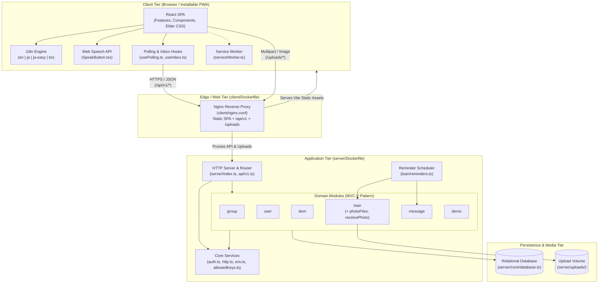
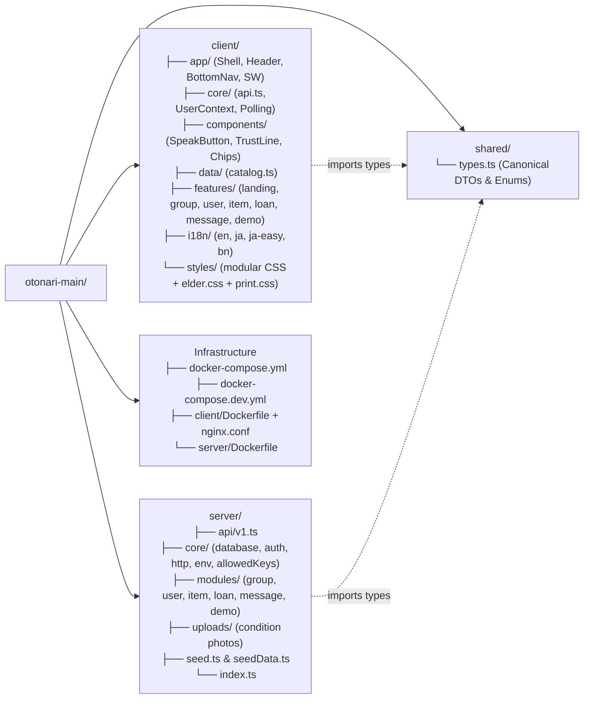
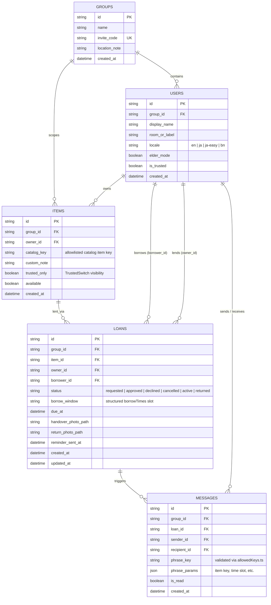
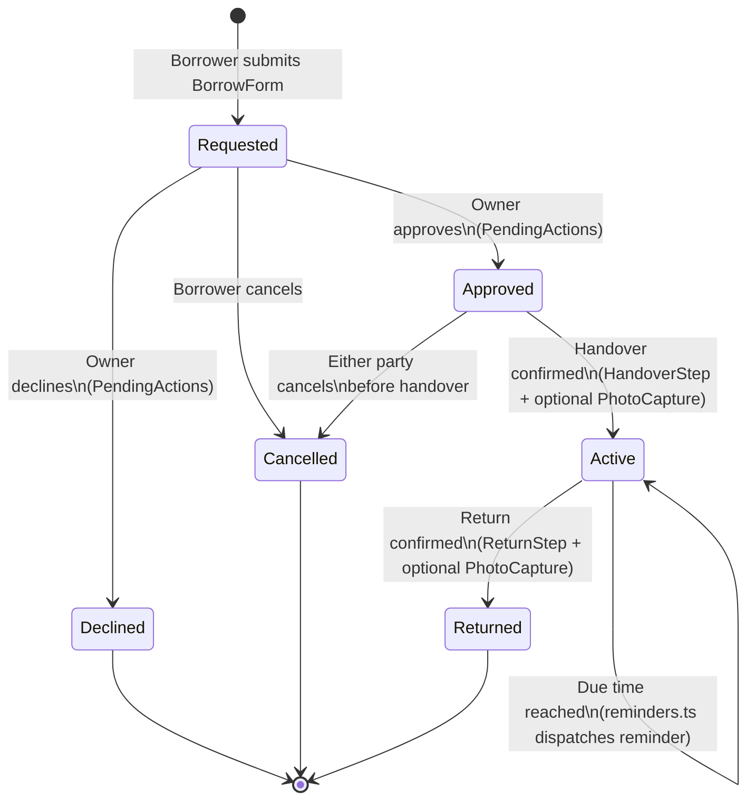
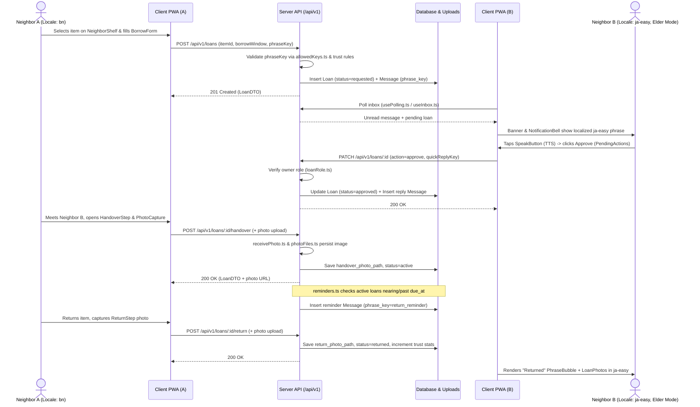
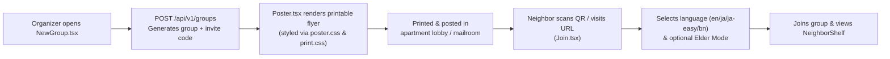
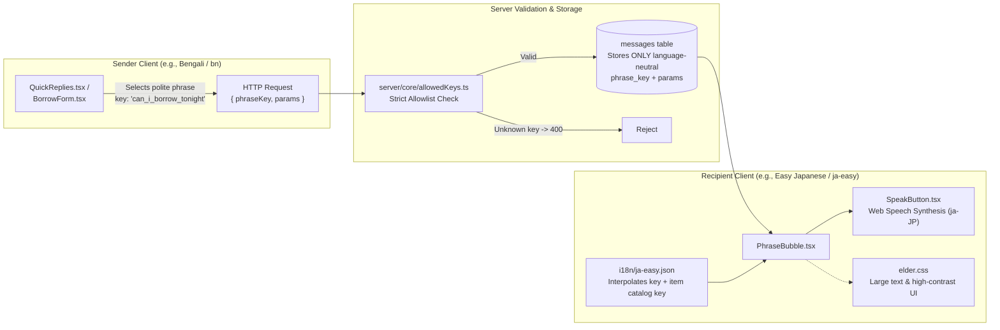
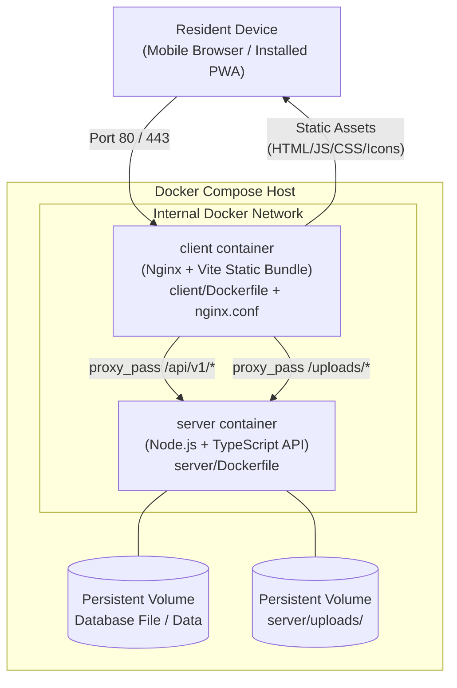

# Otonari — System Design Document

## 1. Executive Summary & Architectural Vision

**Otonari** (_おとなり_, Japanese for "next door / neighbor") is a hyper-local, trust-first neighborhood item-sharing Progressive Web App (PWA). It is specifically engineered to bridge **linguistic** and **generational** barriers within residential communities (such as apartment buildings, dormitories, and neighborhood associations).

### Core Design Pillars

1. **Zero-Friction Cross-Lingual Communication**: Instead of error-prone free-text chat or external machine-translation APIs, Otonari uses **structured, allowlisted phrase keys** (`server/core/allowedKeys.ts`) paired with client-side localization (`en`, `ja`, `ja-easy` / _Yasashii Nihongo_, and `bn`). Every neighbor reads and responds in their preferred language with culturally polite phrasing.
2. **Intergenerational & Elder Accessibility**: Built-in **Elder Mode** (`client/src/styles/elder.css`) enlarges tap targets, typography, and visual contrast, while integrated **Text-to-Speech** (`SpeakButton.tsx`) vocalizes item names and neighbor messages for users with visual or reading difficulties.
3. **Closed-Circle Neighborhood Trust**: Sharing occurs strictly inside invite-only neighborhood groups onboarded physically via printable lobby/bulletin posters (`Poster.tsx` + `print.css`) or invite links (`Join.tsx`). Owners can further restrict sensitive items to trusted neighbors (`TrustedSwitch.tsx`).
4. **Accountability Through Lightweight Proof**: Loans progress through an explicit state machine (`LoanStepper.tsx`) backed by optional/guided handover and return condition photos (`PhotoCapture.tsx`, `receivePhoto.ts`) and automated overdue reminders (`reminders.ts`).
5. **Simplicity & Operational Resilience**: Implemented as a cleanly layered **TypeScript Modular Monolith** with shared domain types (`shared/types.ts`), Nginx static serving + reverse proxying, and resilient HTTP polling (`usePolling.ts`) that gracefully tolerates spotty mobile connections.

---

## 2. High-Level System Architecture

Otonari follows a containerized 3-tier architecture composed of a **React + Vite PWA frontend**, an **Nginx edge proxy**, and a **Node.js/TypeScript modular backend** backed by relational persistence and local media storage.

---

## 3. Repository & Codebase Structure

The repository is organized as a workspace monorepo splitting `client/`, `server/`, and `shared/` contracts to enforce end-to-end type safety without duplicating DTO definitions.

### 3.1 Backend Layering Pattern (MVC-V)

Each domain module under `server/modules/<domain>/` follows a strict four-part separation of concerns:

| Layer              | File Convention                                                                                     | Responsibility                                                                                                                                      |
| :----------------- | :-------------------------------------------------------------------------------------------------- | :-------------------------------------------------------------------------------------------------------------------------------------------------- |
| **Routes**         | `*Routes.ts`                                                                                        | Registers `/api/v1` endpoints, applies auth/role middleware, and delegates to controllers.                                                          |
| **Controller**     | `*Controller.ts`                                                                                    | Validates HTTP inputs (`allowedKeys.ts`, `http.ts`), orchestrates business rules & cross-module workflows, and formats HTTP responses.              |
| **Model**          | `*Model.ts`                                                                                         | Encapsulates SQL queries and state transitions against `server/core/database.ts`.                                                                   |
| **View**           | `*View.ts`                                                                                          | Projects raw database rows into sanitized, contract-compliant API DTOs matching `shared/types.ts` (prevents accidental PII/internal field leakage). |
| **Domain Helpers** | `loanRole.ts`, `leaveGroup.ts`, `removeItem.ts`, `photoFiles.ts`, `receivePhoto.ts`, `reminders.ts` | Isolates complex side-effects such as safe membership teardown, item deletion guards, role enforcement, photo storage, and reminder triggers.       |

### 3.2 Frontend Architecture (Feature-Sliced SPA)

- **App Shell (`client/src/app/`)**: Separates authenticated layout (`Header.tsx`, `BottomNav.tsx`, `navTabs.ts`) from unauthenticated/onboarding views (`PublicHeader.tsx`, `Landing.tsx`), alongside `serviceWorker.ts` registration.
- **Core State & Networking (`client/src/core/`)**:
  - `UserContext.ts`: Manages active neighbor identity, locale, Elder Mode preference, and group context.
  - `api.ts`: Centralized typed HTTP client targeting `/api/v1`.
  - `usePolling.ts` & `useInbox.ts`: Lightweight periodic synchronization for loan updates and unread notifications.
- **Modular Stylesheets (`client/src/styles/`)**: Cleanly decoupled CSS per screen and adaptive mode (`narrow.css`, `wide.css`, `elder.css`, `print.css`), avoiding heavy runtime CSS-in-JS overhead on older devices.

---

## 4. Data Model & Entity-Relationship Design

Persistence is abstracted through `server/core/database.ts`. The schema models five core domain entities isolated by `group_id`.

### Data Integrity & Teardown Rules

- **Safe Item Removal (`server/modules/item/removeItem.ts`)**: Prevents or gracefully handles removing an item that has active loans so borrowers and owners retain history/return accountability.
- **Safe Group Departure (`server/modules/user/leaveGroup.ts`)**: Cleans up or reassigns user availability, withdraws open requests, and prevents orphaned active loans when a resident moves out.
- **Group Partitioning**: Every query on `items`, `loans`, and `messages` is strictly scoped by the authenticated user's `group_id`.

---

## 5. Core Domain Workflows

### 5.1 Loan Lifecycle State Machine

A loan moves through deterministic states visualized in `LoanStepper.tsx` and enforced server-side by `loanController.ts`, `loanModel.ts`, and `loanRole.ts`.

### 5.2 End-to-End Cross-Lingual Borrow, Handover & Return Sequence

The diagram below illustrates how two neighbors speaking different languages (e.g., **Neighbor A** using Bengali `bn` and **Neighbor B** using Easy Japanese `ja-easy` + Elder Mode) complete an entire lending cycle without typing free-form text.

### 5.3 Physical-to-Digital Group Onboarding (Poster Flow)

---

## 6. Cross-Lingual Structured Messaging & Accessibility Architecture

A defining architectural choice in Otonari is **replacing unconstrained chat with structured phrase messaging**.

### Benefits of Structured Key Messaging

- **Zero Hallucination / Mistranslation Risk**: Every message (`SamplePhrase.tsx`, `PhraseBubble.tsx`, `QuickReplies.tsx`) is human-authored and culturally vetted across `en.json`, `ja.json`, `ja-easy.json`, and `bn.json`.
- **Zero External API Latency or Cost**: No third-party translation API keys, rate limits, or privacy leaks of neighbor conversations.
- **Built-in Moderation & Safety**: Eliminates spam, harassment, and off-platform phishing links by design because arbitrary strings cannot be injected into message feeds.
- **Catalog Alignment**: Item names from `client/src/data/catalog.ts` (e.g., step ladder, drill, rice cooker, umbrella) are also key-based, meaning an item registered in Japanese automatically appears localized in English or Bengali on `NeighborShelf.tsx`.

---

## 7. API Surface Specification (`/api/v1`)

All REST endpoints are mounted under `/api/v1` via `server/api/v1.ts` and handled with standardized JSON/error utilities in `server/core/http.ts`.

| Module       | Route File         | Key Capabilities & Endpoints                                                                                                                                                                                                                                                                                                                               |
| :----------- | :----------------- | :--------------------------------------------------------------------------------------------------------------------------------------------------------------------------------------------------------------------------------------------------------------------------------------------------------------------------------------------------------- |
| **Groups**   | `groupRoutes.ts`   | Create neighborhood group (`POST /groups`), look up group by invite code (`GET /groups/:code`), fetch group details/poster metadata.                                                                                                                                                                                                                       |
| **Users**    | `userRoutes.ts`    | Join group / register profile (`POST /users`), login/switch session (`POST /auth/login`), fetch & update profile/locale/elder-mode settings (`GET/PATCH /users/me`), leave group safely (`POST /users/me/leave` via `leaveGroup.ts`).                                                                                                                      |
| **Items**    | `itemRoutes.ts`    | List group neighbor shelf (`GET /items`), list owned items (`GET /items/mine`), inspect single item (`GET /items/:id`), add catalog/custom item (`POST /items`), toggle availability or `trusted_only` (`PATCH /items/:id`), safely remove item (`DELETE /items/:id` via `removeItem.ts`).                                                                 |
| **Loans**    | `loanRoutes.ts`    | List active/past loans (`GET /loans`), get loan detail + timeline (`GET /loans/:id`), create borrow request (`POST /loans`), approve/decline/cancel (`PATCH /loans/:id`), record handover & return transitions with photo upload (`POST /loans/:id/handover`, `POST /loans/:id/return` via `receivePhoto.ts`), post quick reply (`POST /loans/:id/reply`). |
| **Messages** | `messageRoutes.ts` | Poll inbox notifications (`GET /messages`), list loan thread messages (`GET /loans/:id/messages`), mark notifications read (`PATCH /messages/:id/read`).                                                                                                                                                                                                   |
| **Demo**     | `demoRoutes.ts`    | List pre-seeded demo personas (`GET /demo/users`), switch demo identity (`POST /demo/switch`), reset/re-seed sandbox environment (`POST /demo/reset` using `seedData.ts`).                                                                                                                                                                                 |

---

## 8. Real-Time Synchronization, Media Handling & PWA Strategy

### 8.1 Lightweight Polling (`usePolling.ts` & `useInbox.ts`)

- Rather than maintaining stateful WebSocket connections across unstable mobile networks and reverse proxies, the client uses visibility-aware HTTP polling (`usePolling.ts`) to refresh inbox notifications (`NotificationBell.tsx`, `Banner.tsx`) and active loan states (`LoanPage.tsx`).
- **Trade-off**: Slightly higher latency (a few seconds) in exchange for dramatically simpler horizontal scaling, automatic recovery from sleep/background tabs on mobile devices, and trivial Nginx proxying.

### 8.2 Condition Photo Pipeline (`PhotoCapture.tsx` -> `receivePhoto.ts` -> `photoFiles.ts`)

1. Client captures or selects a handover/return photo in `PhotoCapture.tsx`.
2. Uploaded to the loan endpoint and parsed by `server/modules/loan/receivePhoto.ts` (enforcing MIME type and file size constraints).
3. `server/modules/loan/photoFiles.ts` generates safe, non-guessable filenames and stores files inside `server/uploads/`.
4. Images are served back to authorized loan views (`LoanPhotos.tsx`) through Nginx/static routing.

### 8.3 Reminder Engine (`server/modules/loan/reminders.ts`)

- Periodically inspects `active` loans against their scheduled `due_at` timestamps.
- Dispatches idempotent structured reminder messages (tracking `reminder_sent_at` to avoid duplicate pings) so borrowers receive polite localized nudges before/when an item is due back.

### 8.4 Progressive Web App (PWA)

- Configured via `client/vite.config.ts`, `client/index.html`, `client/src/app/serviceWorker.ts`, and maskable icon assets (`icon-192.png`, `icon-512.png`, `icon-maskable-512.png`).
- Enables one-tap **"Add to Home Screen"** installation on iOS and Android—essential for elderly residents who struggle with browser URL bars and bookmarks.

---

## 9. Security, Privacy & Trust Model

| Dimension                         | Mechanism in Codebase                           | Protection Provided                                                                                                                                                                              |
| :-------------------------------- | :---------------------------------------------- | :----------------------------------------------------------------------------------------------------------------------------------------------------------------------------------------------- |
| **Authentication**                | `server/core/auth.ts`, `Login.tsx`              | Identifies the active user session and injects authenticated context into route handlers.                                                                                                        |
| **Role-Based Loan Authorization** | `server/modules/loan/loanRole.ts`               | Enforces participant checks: only the **owner** can approve/decline; only the **borrower** can submit a borrow request; only loan participants can view photos or advance handover/return steps. |
| **Group Isolation**               | `groupModel.ts`, `itemModel.ts`, `loanModel.ts` | Prevents cross-group data enumeration; users only see items and neighbors inside their own residential group.                                                                                    |
| **Two-Tier Item Trust**           | `TrustedSwitch.tsx`, `TrustLine.tsx`            | Allows owners to mark higher-value or personal items as visible only to neighbors with established trust history.                                                                                |
| **Input & Key Allowlisting**      | `server/core/allowedKeys.ts`                    | Rejects arbitrary/malicious message keys, invalid locales, or unsupported catalog identifiers at the API boundary.                                                                               |
| **DTO Projection**                | `*View.ts` (all domain modules)                 | Whitelists outbound fields so internal DB columns or sensitive metadata are never serialized to clients.                                                                                         |
| **Safe File Uploads**             | `receivePhoto.ts`, `photoFiles.ts`              | Prevents path traversal, restricts upload types/sizes, and isolates stored media in `server/uploads/`.                                                                                           |

---

## 10. Deployment & Infrastructure Architecture

Otonari is containerized for single-command deployment via Docker Compose (`docker-compose.yml` for production-like execution and `docker-compose.dev.yml` for local hot-reload development).

### Seeding & Demo Mode

- For evaluations, community workshops, and onboarding demos, `server/seed.ts` and `server/seedData.ts` populate realistic multilingual neighbors, household items, and in-progress loans.
- `DemoUsers.tsx` and `DemoButtons.tsx` interact with `demoRoutes.ts` / `demoController.ts` to allow instant persona switching (e.g., switching between an elderly Japanese resident and an English- or Bengali-speaking student neighbor) without logging out and re-registering.

---

## 11. Architectural Trade-offs & Future Scalability Path

### Key Decisions & Trade-offs

| Decision                     | Chosen Approach                                       | Trade-off / Limitation                                              | Mitigation / Future Evolution                                                                                                    |
| :--------------------------- | :---------------------------------------------------- | :------------------------------------------------------------------ | :------------------------------------------------------------------------------------------------------------------------------- |
| **Messaging Model**          | Allowlisted structured phrase keys (`allowedKeys.ts`) | Cannot discuss arbitrary edge-case details in free text             | Expand curated phrase packs + structured time/location chips (`borrowTimes.ts`, `ChipGroup.tsx`).                                |
| **Real-Time Updates**        | Periodic HTTP polling (`usePolling.ts`)               | Minor delay between action and notification; repeated idle requests | Migrate `useInbox.ts` to **Server-Sent Events (SSE)** or **Web Push Notifications** via `serviceWorker.ts`.                      |
| **Application Architecture** | Modular Monolith (`server/modules/*`)                 | Shared process memory/CPU across domains                            | Strict MVC-V boundaries make extracting services (e.g., media or notifications) straightforward if needed.                       |
| **Media Storage**            | Local container volume (`server/uploads/`)            | Tied to single host; no multi-node shared filesystem                | Abstract `photoFiles.ts` behind an S3-compatible object storage adapter (e.g., Cloudflare R2 / MinIO / AWS S3) with signed URLs. |
| **Database Layer**           | Single relational store (`server/core/database.ts`)   | Single-node write ceiling                                           | Move to managed PostgreSQL with read replicas and connection pooling if scaling across thousands of residential buildings.       |

### Recommended Next Milestones

1. **Web Push & VAPID Integration**: Leverage the existing `serviceWorker.ts` to deliver OS-level push alerts for borrow requests and return reminders even when the PWA is closed.
2. **Offline Read Cache**: Cache the neighbor's shelf and active loan details in the Service Worker for instant loading in apartment elevators and basements with poor reception.
3. **Photo Access Authorization**: Serve `server/uploads/` photos exclusively via authenticated, loan-scoped endpoints (or short-lived signed URLs) rather than open static paths.
4. **Additional Community Locales**: Extend `client/src/i18n/` (e.g., Vietnamese, Nepali, Chinese, Tagalog) simply by adding new JSON translation dictionaries—requiring zero backend schema changes.
