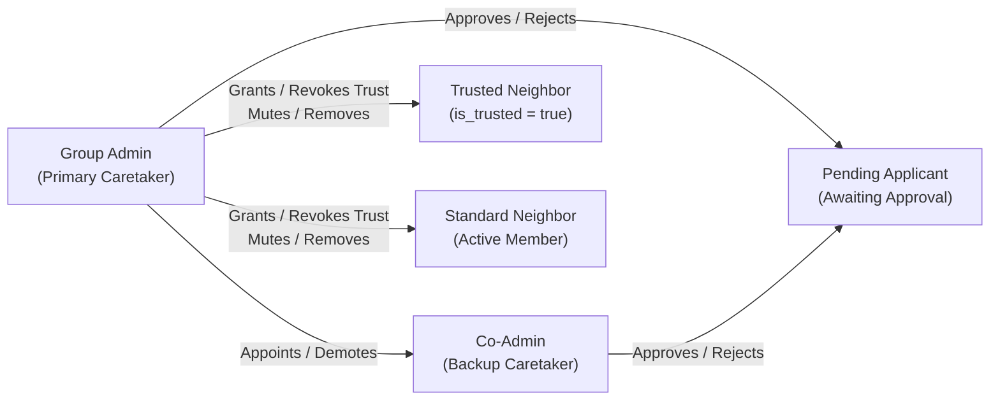
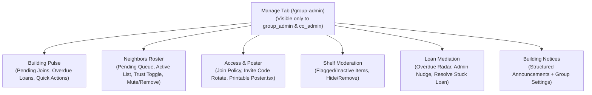
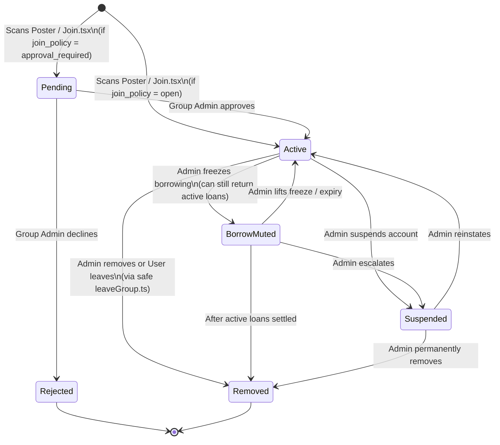
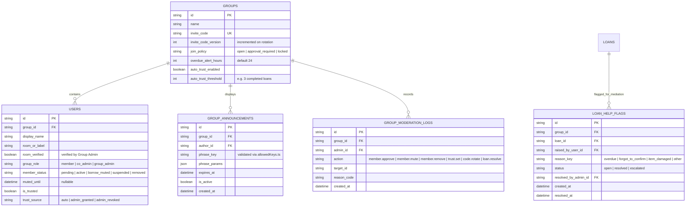
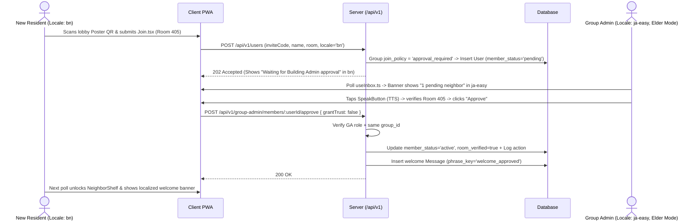
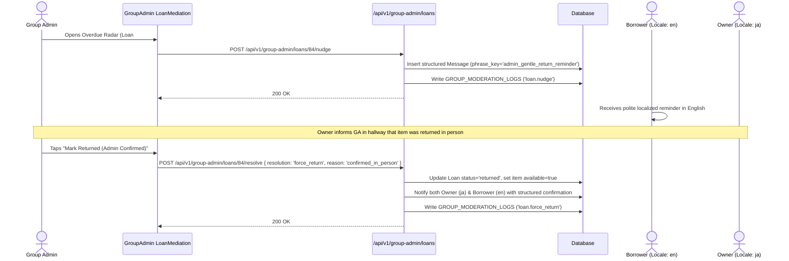

# Otonari — Group Admin Panel System Design

## 1. Executive Summary & Role Philosophy

In **Otonari**, a **Group Admin** (such as an apartment manager, neighborhood association / _chōnaikai_ officer, dormitory RA, or community volunteer) is the **trusted local caretaker** who controls who enters the neighborhood group, nurtures community trust, and gently resolves borrowing friction.

### Design Principles

1. **Intergenerational & Elder-Friendly Admin UX**: In many residential buildings, the community leader is an older resident. Every Group Admin screen **must** fully support **Elder Mode** (`client/src/styles/elder.css`), large touch targets, **Text-to-Speech** (`SpeakButton.tsx`), and all four locales (`en`, `ja`, `ja-easy`, `bn`).
2. **Strict Single-Group Isolation**: A Group Admin's authority is hard-scoped to their own `group_id`. Every backend query enforces `WHERE group_id = req.user.group_id`.
3. **High-Trust, Low-Friction Control**: Group Admins can gatekeep membership, verify neighbors, grant trust badges (`TrustedSwitch.tsx`), rotate lobby invite codes, moderate shelf items, and send polite structured nudges without writing awkward confrontation messages.
4. **Accountability Without Tyranny**: Sensitive actions (suspending a neighbor, force-closing a loan, rotating an invite code) are logged in a group-level activity log visible to Co-Admins and reviewable by Super Admins if disputed.

---

## 2. Neighbor Control Matrix & Role Scope

Within a single neighborhood group (`group_id`), Otonari supports four member tiers:



| Neighbor Control Action                                  | Primary Group Admin | Co-Admin | Trusted Neighbor |   Standard Neighbor    |
| :------------------------------------------------------- | :-----------------: | :------: | :--------------: | :--------------------: |
| Approve or reject pending join requests                  |         Yes         |   Yes    |        No        |           No           |
| Verify neighbor room/floor badge & edit label            |         Yes         |   Yes    |        No        |    Own profile only    |
| Grant or revoke `is_trusted` badge                       |         Yes         |   Yes    |        No        |           No           |
| Mute / temporarily suspend a neighbor from borrowing     |         Yes         |   Yes    |        No        |           No           |
| Remove a neighbor from the group (safe teardown)         |         Yes         |   Yes    |        No        |    Self-leave only     |
| Rotate group invite code / lock new joins / print Poster |         Yes         |   Yes    |        No        | Print poster (if open) |
| Hide or remove inappropriate/broken shelf items          |         Yes         |   Yes    |    Own items     |       Own items        |
| View overdue loans & send structured Admin Nudge         |         Yes         |   Yes    |        No        |           No           |
| Mediate stuck/disputed loans (force-return / cancel)     |         Yes         |   Yes    |        No        |           No           |
| Post multilingual group announcements (`Banner.tsx`)     |         Yes         |   Yes    |        No        |           No           |
| Promote/demote Co-Admin & transfer primary ownership     |         Yes         |    No    |        No        |           No           |

---

## 3. Information Architecture & Mobile/Elder-Friendly UI

The Group Admin Panel lives directly inside the main Otonari PWA as a conditionally rendered **"Manage" (`管理`)** tab in `BottomNav.tsx` and `Header.tsx`—ensuring community leaders never need a separate app or desktop browser.

### Navigation Structure



### Mobile UI Wireframe (Elder-Mode Compatible)

```text
+------------------------------------------+
| [Otonari]  Sakura Heights   [Bell(2)]    |
+------------------------------------------+
|  MANAGE BUILDING            [Speak TTS]  |
|                                          |
|  !! NEEDS ATTENTION                      |
|  +------------------------------------+  |
|  | [2] New neighbors waiting to join  |  |
|  |     [ Review Requests  -> ]        |  |
|  +------------------------------------+  |
|  | [1] Loan is 3 days overdue         |  |
|  |     [ Send Polite Nudge -> ]       |  |
|  +------------------------------------+  |
|                                          |
|  NEIGHBORS (38 Active)                   |
|  [ All ] [ Pending (2) ] [ Trusted ]     |
|  +------------------------------------+  |
|  | Tanaka-san (Room 302)  [Trusted *] |  |
|  | Loans: 12 returned | Lang: ja-easy |  |
|  | [ Trust ]  [ Details / Actions ]   |  |
|  +------------------------------------+  |
|  | Karim (Room 405)       [New]       |  |
|  | Loans: 0 | Lang: bn                |  |
|  | [ Approve Trust ] [ Mute / Remove ]|  |
|  +------------------------------------+  |
|                                          |
|  BUILDING ACCESS                         |
|  Join Mode: [ Admin Approval Required ]  |
|  Invite Code: SAKURA-742  [ Rotate ]     |
|  [ Print Lobby Poster (Poster.tsx) ]     |
+------------------------------------------+
| [Shelf] [My Items] [Loans] [*Manage*]    |
+------------------------------------------+
```

---

## 4. Core Neighbor-Control Modules

### 4.1 Neighbor Onboarding & Gatekeeping

Group Admins choose one of three **Join Policies** for their building:

1. **Open with Invite Code** (default for small/trusted buildings): Anyone scanning the lobby poster joins immediately.
2. **Approval Required** (recommended for larger apartments): Scanning `Poster.tsx` / `Join.tsx` creates a `pending` neighbor profile; the resident can browse a welcome card while awaiting one-tap approval by the Group Admin.
3. **Locked (Invite Paused)**: Temporarily blocks all new registrations while keeping existing neighbors active.

- **Room/Unit Verification**: When reviewing a pending applicant, the Group Admin sees their entered `display_name`, `room_or_label`, and chosen language, allowing them to verify the person actually lives in the building before approving.

### 4.2 Controlling Neighbor Trust (`TrustedSwitch.tsx` Integration)

- **Automatic vs. Admin-Managed Trust**: While neighbors naturally earn trust by completing on-time returns (`TrustLine.tsx`), Group Admins can:
  - **Manually Endorse (`is_trusted = true`)**: Immediately vouch for a known long-term resident (e.g., an elderly neighbor who just joined the app) so they can access `trusted_only` items.
  - **Revoke Trust (`is_trusted = false`)**: Downgrade a resident after repeated late returns or carelessness, restricting them to public-tier items only.

### 4.3 Neighbor Restrictions: Mute, Suspend & Safe Removal

When a resident violates building etiquette or moves out:

- **Borrowing Freeze (`borrow_muted`)**: The neighbor can still return currently borrowed items and reply to active loans, but cannot submit new `BorrowForm` requests for a chosen duration (e.g., 7 days, 30 days, or until lifted).
- **Suspend Member (`suspended`)**: Temporarily revokes group access while preserving loan history and audit records.
- **Remove Member (Extends `server/modules/user/leaveGroup.ts`)**:
  - **Guardrail**: If the neighbor currently holds an `active` borrowed item, the system warns the Group Admin and offers two safe paths: (a) **Freeze & Await Return** (`borrow_muted`), or (b) **Force-Remove & Mark Item Disputed** (creates a mediation record and notifies the item owner via structured message).
  - Automatically withdraws all `requested` (pending) loans and archives the removed user's shelf items.

### 4.4 Invite Code & Lobby Poster Governance

- **One-Tap Invite Code Rotation**: If a lobby poster QR code is shared outside the apartment building, the Group Admin taps **Rotate Code**. The old QR/invite link is immediately invalidated and `Poster.tsx` dynamically regenerates a fresh printable flyer with the new code.
- **Custom Building Note**: Edit the localized welcome note shown on `Join.tsx` and the printed lobby flyer.

### 4.5 Shelf & Item Moderation (Extends `server/modules/item/removeItem.ts`)

- **Visibility Control**: Group Admins can inspect all items listed on `NeighborShelf.tsx` and **Hide** (mark unavailable) or **Remove** prohibited, unsafe, or stale items (e.g., an item left behind by an inactive user).
- **Owner Notification**: Removing or hiding an item automatically dispatches a polite, localized structured notice to the owner (e.g., `admin_item_hidden_safety` or `admin_item_archived_stale`).

### 4.6 Loan Oversight & Gentle Cross-Lingual Mediation

To respect neighbor privacy, Group Admins do **not** read every routine loan by default. Instead, they see an **Attention Queue** surfaced by rules:

1. **Overdue Radar**: Lists loans past `due_at` by more than a configurable threshold (e.g., 24 hours).
2. **Disputed / Flagged Loans**: Loans where either the borrower or owner tapped **"Ask Building Admin for Help"**.
3. **Mediation Actions**:
   - **Send Polite Admin Nudge**: Dispatches a vetted, non-confrontational structured phrase (`admin_gentle_return_reminder`) rendered in the borrower's preferred language (`en`, `ja`, `ja-easy`, `bn`).
   - **Inspect Condition Photos**: For flagged/overdue loans only, view `handover_photo_path` and `return_photo_path` (`LoanPhotos.tsx`).
   - **Force-Resolve Stuck Loan**: Mark an item as `returned` (e.g., when an elderly resident returned the item in person and forgot to tap the app) or `cancelled`, logging the admin intervention in the loan timeline.
   - **Escalate to Super Admin**: Forward serious damage or harassment cases directly to the Super Admin Safety Queue.

### 4.7 Structured Building Announcements (`Banner.tsx`)

- Group Admins can pin a building-wide banner (e.g., _"Building fire drill this Sunday"_, _"Welcome new neighbors!"_, _"Please return shared umbrellas after rain"_) using **curated multilingual announcement templates** or structured date/time chips—ensuring every resident reads it in their own language with TTS support (`SpeakButton.tsx`).

### 4.8 Co-Admin Delegation & Succession Handover

- Primary Group Admins can promote one or more trusted neighbors to **Co-Admin** to share duties.
- **Last-Admin Lock**: Modifying `server/modules/user/leaveGroup.ts` prevents the _sole_ Group Admin from leaving the building group until they either transfer Primary Admin ownership to another active member or request archival/Super Admin handover.

---

## 5. Member Lifecycle & Control State Machine



---

## 6. Data Model Extensions

These targeted additions extend `server/core/database.ts` cleanly without breaking existing resident flows:



---

## 7. Key Operational Sequence Diagrams

### 7.1 Neighbor Join Approval & Manual Trust Endorsement



### 7.2 Overdue Loan Gentle Mediation & Force-Completion



---

## 8. Backend Architecture & API Specification

Implemented as a dedicated domain module adhering to Otonari's MVC-V structure:

```text
server/
├── core/
│   └── auth.ts                      # Extended with requireGroupAdmin() + group_id guard
└── modules/
    └── groupAdmin/
        ├── groupAdminRoutes.ts      # Mounted at /api/v1/group-admin
        ├── groupAdminController.ts  # Validates input, role, and active-loan guards
        ├── groupAdminModel.ts       # Strictly group_id-scoped SQL operations
        ├── groupAdminView.ts        # Projects sanitized neighbor & moderation DTOs
        ├── memberControl.ts         # Safe mute/suspend/remove (wraps leaveGroup.ts)
        └── loanMediation.ts         # Overdue queries, nudges, and force-resolve logic
```

### REST Endpoints (`/api/v1/group-admin`)

All endpoints automatically resolve `groupId` from the authenticated admin session (`req.user.group_id`) rather than trusting client-supplied group IDs.

| Method   | Endpoint                   | Purpose                                                                                        | Who             |
| :------- | :------------------------- | :--------------------------------------------------------------------------------------------- | :-------------- |
| `GET`    | `/dashboard`               | Counts of pending members, overdue/flagged loans, active members, join policy                  | GA / Co-Admin   |
| `GET`    | `/members`                 | List group neighbors filterable by `status` (`pending`, `active`, `borrow_muted`, `suspended`) | GA / Co-Admin   |
| `POST`   | `/members/:userId/approve` | Approve pending applicant (optional `roomVerified`, `grantTrust`)                              | GA / Co-Admin   |
| `POST`   | `/members/:userId/reject`  | Decline pending join request                                                                   | GA / Co-Admin   |
| `PATCH`  | `/members/:userId/trust`   | Manually grant or revoke `is_trusted` badge                                                    | GA / Co-Admin   |
| `PATCH`  | `/members/:userId/status`  | Set `borrow_muted` (with `mutedUntil`), `suspended`, or reinstate to `active`                  | GA / Co-Admin   |
| `DELETE` | `/members/:userId`         | Safely remove neighbor from group (enforces active-loan protection)                            | GA / Co-Admin   |
| `PATCH`  | `/members/:userId/role`    | Promote/demote `co_admin` or transfer primary `group_admin` role                               | Primary GA only |
| `PATCH`  | `/settings`                | Update `join_policy`, `overdue_alert_hours`, `auto_trust_threshold`, welcome note              | GA / Co-Admin   |
| `POST`   | `/invite-code/rotate`      | Invalidate old invite code and generate fresh code for `Poster.tsx`                            | GA / Co-Admin   |
| `GET`    | `/items`                   | View all shelf items in group for moderation                                                   | GA / Co-Admin   |
| `PATCH`  | `/items/:itemId/moderate`  | Hide (`available = false`) or remove item via `removeItem.ts` with structured notice           | GA / Co-Admin   |
| `GET`    | `/loans/attention`         | List overdue loans and user-flagged help requests (`LOAN_HELP_FLAGS`)                          | GA / Co-Admin   |
| `POST`   | `/loans/:loanId/nudge`     | Send polite localized admin reminder (rate-limited to 1 per 24h per loan)                      | GA / Co-Admin   |
| `POST`   | `/loans/:loanId/resolve`   | Force-return or cancel a stuck loan, or escalate dispute to Super Admin                        | GA / Co-Admin   |
| `POST`   | `/announcements`           | Publish structured multilingual building notice to `Banner.tsx`                                | GA / Co-Admin   |
| `GET`    | `/activity-log`            | View group moderation history (`GROUP_MODERATION_LOGS`)                                        | GA / Co-Admin   |

---

## 9. Edge Cases & Safety Guardrails

1. **Preventing Group Lockout (Last-Admin Protection)**:
   - `leaveGroup.ts` checks `SELECT COUNT(*) FROM users WHERE group_id = ? AND group_role = 'group_admin' AND member_status = 'active'`. If count is `1`, the admin must first promote a successor via `PATCH /members/:userId/role` before leaving.
2. **Preventing Self-Sabotage**:
   - A Group Admin cannot mute, suspend, or remove themselves through the member control endpoints; a Co-Admin cannot demote or suspend the Primary Group Admin.
3. **Active Loan Integrity on Member Removal**:
   - Removing a neighbor who currently possesses someone else's item cannot silently delete the loan record. The item's `active` loan transitions to a tracked mediation state so the owner always knows what happened and can escalate if necessary.
4. **Anti-Harassment Rate Limits on Nudges**:
   - Even Group Admins cannot spam neighbors: `POST /loans/:loanId/nudge` is strictly allowlisted via `allowedKeys.ts` and capped at **1 nudge per 24 hours per loan**.
5. **Group Boundary Enforcement**:
   - Every `:userId`, `:itemId`, and `:loanId` target is verified to belong to `req.user.group_id` inside `groupAdminModel.ts`; mismatched IDs return `404 Not Found` to prevent cross-building ID probing.

---

## 10. Frontend Codebase Integration

```text
client/src/
├── app/
│   └── navTabs.ts                     # Conditionally appends 'manage' tab for group_admin/co_admin
├── features/
│   └── groupAdmin/
│       ├── GroupAdminHome.tsx         # Building pulse + pending/overdue attention cards
│       ├── MemberRoster.tsx           # Filter tabs (Pending/Active/Muted) + search
│       ├── MemberActionSheet.tsx      # Large Elder-friendly controls: Trust, Mute, Remove, Co-Admin
│       ├── AccessAndPoster.tsx        # Join policy selector, code rotation, Poster.tsx launch
│       ├── ShelfModeration.tsx        # Hide/remove group items with structured reason chips
│       ├── LoanMediation.tsx          # Overdue radar, 1-tap polite nudge, force-resolve, escalate
│       ├── BuildingNoticeForm.tsx     # Structured announcement picker for Banner.tsx
│       └── GroupActivityLog.tsx       # Transparent moderation log for Admins & Co-Admins
└── styles/
    └── group-admin.css                # Mobile-first + Elder Mode overrides (large hit targets)
```

### Localization & Accessibility Checklist

- Add a `groupAdmin.*` namespace to `client/src/i18n/en.json`, `ja.json`, `ja-easy.json`, and `bn.json`.
- Add admin-specific structured keys (e.g., `welcome_approved`, `admin_gentle_return_reminder`, `admin_item_hidden_safety`, `admin_force_returned`) to `server/core/allowedKeys.ts`.
- Wrap every action card title and pending-request summary with `SpeakButton.tsx` so senior community leaders can listen to requests before tapping approve or nudge.
