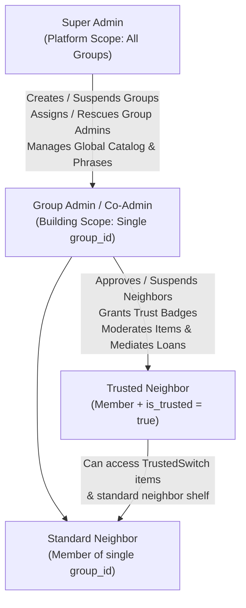
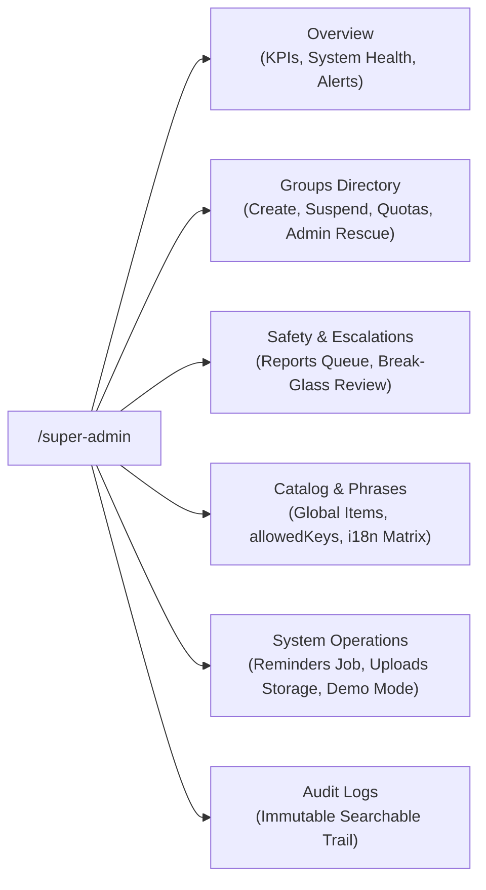
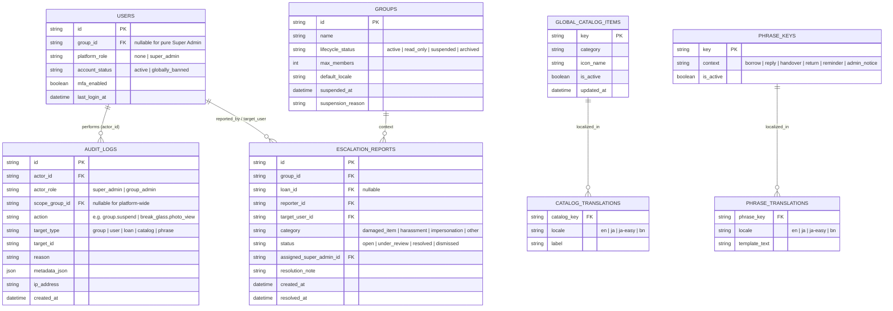
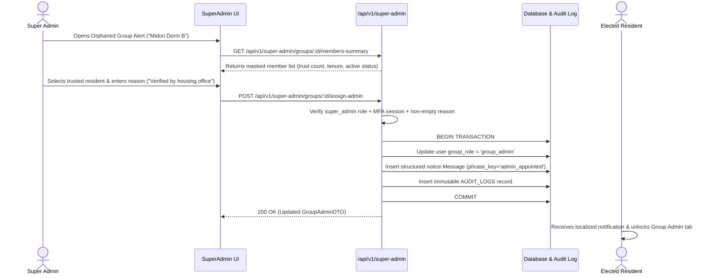
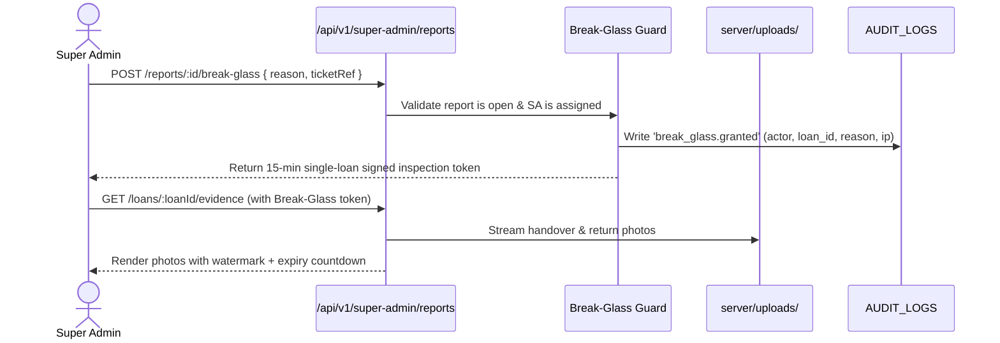

# Otonari — Super Admin Panel System Design

## 1. Executive Summary & Role Scope

The **Super Admin Panel** is the platform-level governance, operations, and safety console for **Otonari**. While day-to-day neighbor management belongs to each building's **Group Admin**, the Super Admin oversees the health, integrity, localization quality, and multi-group safety of the entire Otonari deployment.

### Design Principles

1. **Strict Separation of Concerns**: Super Admins govern *groups, platform rules, global catalogs, and escalated safety cases*—they do not micromanage routine neighborhood lending.
2. **Privacy by Default (Zero-Snoop Architecture)**: Resident identities, room labels, and handover/return condition photos (`server/uploads/`) are masked or inaccessible to Super Admins unless an explicit, time-boxed **"Break-Glass" Audit Reason** is recorded for an escalated safety dispute.
3. **Architecture Alignment**: Extends Otonari's existing **TypeScript Modular Monolith** (`server/modules/` MVC-V pattern), `shared/types.ts` contracts, and feature-sliced React SPA (`client/src/features/`).
4. **Immutable Accountability**: Every mutating Super Admin action (suspending a group, reassigning a Group Admin, editing allowlisted phrase keys, or inspecting an escalated report) writes to an append-only audit log.

---

## 2. Role-Based Access Control (RBAC) Hierarchy



| Capability | Super Admin | Group Admin | Neighbor |
| :--- | :---: | :---: | :---: |
| View platform-wide metrics & all neighborhood groups | Yes | No | No |
| Create, suspend, archive, or restore any group | Yes | No | No |
| Appoint, demote, or rescue a Group Admin for any building | Yes | Co-Admin only (own group) | No |
| Manage global item catalog (`catalog.ts`) & phrase keys (`allowedKeys.ts`) | Yes | No | No |
| Monitor i18n coverage (`en`, `ja`, `ja-easy`, `bn`) & add new locales | Yes | No | No |
| Handle escalated abuse reports & cross-group bans | Yes | Local group only | Report only |
| Manage Demo Sandbox & seed resets (`demoController.ts`) | Yes | No | Demo mode only |
| Manage storage retention (`server/uploads/`) & reminder daemon | Yes | No | No |
| View unmasked neighbor loan photos | Break-Glass (Audited) | Own group disputes | Own loans only |

---

## 3. Information Architecture & UI Wireframe

Unlike the resident app (which is mobile-first with `BottomNav.tsx`), the Super Admin Panel is a **desktop-optimized operational console** mounted under `/super-admin/*` and lazily code-split in Vite so standard residents never download admin bundles.

### Navigation Sitemap



### Console Layout Blueprint

```text
+---------------------------------------------------------------------------------+
| [Otonari SUPER ADMIN]   Env: PRODUCTION   Health: OK   [Audit Mode] [Admin Menu]|
+--------------------+------------------------------------------------------------+
|  NAVIGATION        |  PLATFORM OVERVIEW                                         |
|                    |  +-------------+ +-------------+ +------------+ +--------+ |
| > Overview         |  | Active Grps | | Active Usrs | | Open Loans | | Reports| |
|   Groups (42)      |  |     42      | |    1,284    | |     89     | |   3 !  | |
|   Safety Queue (3) |  +-------------+ +-------------+ +------------+ +--------+ |
|   Catalog & i18n   |                                                            |
|   Operations       |  GROUP HEALTH & ANOMALIES                 [+ New Group]    |
|   Demo Sandbox     |  +-------------------------------------------------------+ |
|   Audit Logs       |  | Group Name       | Admin   | Members | Overdue | Stat | |
|                    |  | Sakura Heights   | Sato    |   38    |    1    | OK   | |
|                    |  | Midori Dorm B    | NONE !  |   24    |    4    | WARN | |
|                    |  | Riverview Tower  | Rahman  |   61    |    0    | OK   | |
|                    |  +-------------------------------------------------------+ |
|                    |                                                            |
|                    |  RECENT AUDIT EVENTS                                       |
|                    |  * 14:22 SA-01 reassigned Group Admin for Midori Dorm B    |
|                    |  * 13:05 SA-02 added catalog key 'folding_step_stool'      |
+--------------------+------------------------------------------------------------+
```

---

## 4. Core Functional Modules

### 4.1 Platform Telemetry & Health Dashboard
* **Community KPIs**: Total active groups, active neighbors, weekly completed loans, loan completion rate, overdue loan ratio, and language distribution (`en`, `ja`, `ja-easy`, `bn`, plus Elder Mode adoption percentage).
* **Orphaned Group Alerts**: Automatically flags any residential group whose last Group Admin became inactive or left without a successor, enabling rapid Admin Rescue.
* **System Vitals**: Database connectivity (`server/core/database.ts`), reminder scheduler heartbeat (`server/modules/loan/reminders.ts`), and `server/uploads/` disk utilization.

### 4.2 Neighborhood Group Lifecycle Management
* **Provisioning**: Create verified building groups on behalf of municipal housing offices, universities, or neighborhood associations, pre-configuring member caps (`max_members`), default locale, and join policy.
* **Admin Assignment & Rescue**: Assign initial Group Admins or promote an active trusted neighbor when an existing Group Admin loses device access.
* **Lifecycle States**:
  * `active`: Normal operation.
  * `read_only`: Freezes new borrow requests while allowing active loans to be returned cleanly.
  * `suspended`: Blocks all group access (used for policy violations or decommissioned buildings).
  * `archived`: Soft-deleted historical state with scheduled media purge.

### 4.3 Global Catalog & Structured Phrase Governance
Because Otonari's cross-lingual engine relies on strictly allowlisted keys (`server/core/allowedKeys.ts` and `client/src/data/catalog.ts`), the Super Admin Panel provides safe governance over shared vocabulary:
* **Catalog Registry**: Add, deprecate, or categorize standard borrowable items (e.g., tools, kitchenware, emergency supplies) with icon mappings (`Icons.tsx`).
* **Phrase Key Manager**: Manage structured polite phrases (`BorrowForm`, `QuickReplies`, `reminders`) and enforce **100% translation completeness** across `en`, `ja`, `ja-easy`, and `bn` before a phrase key can be activated.
* **Locale Rollout**: Enable/disable community languages globally or test new dictionaries in staging before enabling for residents.

### 4.4 Safety, Escalations & Break-Glass Inspection
* **Escalation Queue**: Receives reports escalated by Group Admins or platform-level abuse flags (e.g., suspected spam accounts joining multiple groups).
* **Audited Break-Glass Evidence Viewer**: If a damaged-item or harassment dispute is escalated beyond the building level, a Super Admin must submit a `case_id` and mandatory `reason`. The backend grants a **15-minute signed, read-only token** to inspect the specific loan's metadata and `LoanPhotos`, logging the access permanently.
* **Global Account Restrictions**: Ban malicious actors across all groups and revoke active sessions immediately.

### 4.5 System Operations & Demo Sandbox Control
* **Media Storage Hygiene**: View `server/uploads/` usage, trigger orphan-file cleanup (removing images not linked to any loan), and configure auto-retention windows (e.g., purge returned loan photos after 90 days unless flagged in a dispute).
* **Reminder Daemon Monitor**: Inspect last run timestamp, queued reminders, and manually trigger a dry-run or retry of `server/modules/loan/reminders.ts`.
* **Demo Mode Governance**: Enable/disable public Demo Mode (`demoRoutes.ts`), monitor demo reset frequency, and protect production builds from accidental seed resets.

---

## 5. Data Model Extensions

The Super Admin feature extends `server/core/database.ts` with platform roles, group lifecycle status, governance registries, escalation reports, and immutable audit logs.



---

## 6. Operational Workflows (Sequence Diagrams)

### 6.1 Group Admin Rescue & Reassignment

When an apartment's only Group Admin loses their phone or moves out unexpectedly, the Super Admin executes an audited rescue without disrupting active loans.



### 6.2 Audited Break-Glass Inspection for Escalated Disputes



---

## 7. Backend Architecture & API Specification

Following Otonari's MVC-V architecture, platform administration is isolated in a dedicated module:

```text
server/
├── core/
│   ├── auth.ts                 # Extended with requireSuperAdmin() & MFA check
│   └── audit.ts                # Append-only audit writer shared by SA & GA
└── modules/
    └── superAdmin/
        ├── superAdminRoutes.ts
        ├── superAdminController.ts
        ├── superAdminModel.ts
        ├── superAdminView.ts   # Enforces PII masking on non-break-glass views
        ├── breakGlass.ts       # Time-boxed scoped token issuance
        └── storageMaintenance.ts # Orphaned photo scanner & retention cleaner
```

### REST Endpoints (`/api/v1/super-admin`)

| Method | Endpoint | Purpose | Audit Logged |
| :--- | :--- | :--- | :---: |
| `GET` | `/overview` | Platform KPIs, language stats, orphaned group alerts, daemon status | No |
| `GET` | `/groups` | Paginated, filterable directory of all neighborhood groups | No |
| `POST` | `/groups` | Provision a new group with quotas and initial settings | Yes |
| `PATCH` | `/groups/:groupId/status` | Transition group between `active`, `read_only`, `suspended`, `archived` | Yes |
| `POST` | `/groups/:groupId/assign-admin` | Promote/demote a Group Admin (requires `reason`) | Yes |
| `GET` | `/reports` | List escalated safety/dispute reports across all groups | No |
| `POST` | `/reports/:reportId/break-glass` | Issue 15-minute audited evidence token for a specific escalated loan | Yes |
| `PATCH` | `/reports/:reportId/resolve` | Record resolution, optionally globally ban malicious account | Yes |
| `GET` | `/catalog` | Fetch global item catalog and i18n translation matrix | No |
| `POST` / `PATCH` | `/catalog/:key` | Create/update catalog item (validates all active locales before publish) | Yes |
| `GET` / `PATCH` | `/phrases/:key` | Inspect/update allowlisted structured phrase keys (`allowedKeys.ts`) | Yes |
| `GET` | `/operations/health` | DB metrics, `reminders.ts` last run, `server/uploads/` disk usage | No |
| `POST` | `/operations/cleanup-uploads` | Dry-run or execute retention & orphan media cleanup | Yes |
| `POST` | `/operations/demo-mode` | Toggle or reset Demo Sandbox (`demoController.ts`) | Yes |
| `GET` | `/audit-logs` | Search/export immutable platform and group admin audit trails | No |

---

## 8. Security & Privacy Guardrails

1. **Dedicated Authentication & Session Hardening**:
   * Super Admin accounts cannot be switched into via `DemoUsers.tsx` or `demoRoutes.ts` under any circumstance.
   * Requires stronger authentication (passkey / TOTP MFA) and short idle session timeouts (e.g., 30 minutes).
   * Optional IP allowlist enforced at `client/nginx.conf` for `/api/v1/super-admin/*`.
2. **Minimum Necessary Data Exposure**:
   * `superAdminView.ts` strips room numbers and personal notes by default in group member summaries, showing only pseudonymous IDs, trust scores, and activity counts unless escalated.
3. **Immutable Audit Logs**:
   * Database permissions / model layer expose `INSERT` and `SELECT` only on `AUDIT_LOGS`—no `UPDATE` or `DELETE` endpoints exist.
4. **Two-Step Destructive Confirmation**:
   * Suspending an active group or globally banning a user requires typing the target identifier plus a structured reason code.

---

## 9. Frontend Codebase Integration

```text
client/src/
├── features/
│   └── superAdmin/
│       ├── SuperAdminShell.tsx       # Desktop sidebar shell (lazy-loaded route)
│       ├── PlatformOverview.tsx      # KPI cards + system health + orphan alerts
│       ├── GroupsDirectory.tsx       # Filterable table + status/admin rescue modal
│       ├── SafetyQueue.tsx           # Escalation triage + Break-Glass viewer
│       ├── CatalogPhraseStudio.tsx   # Side-by-side en/ja/ja-easy/bn editor
│       ├── OperationsPanel.tsx       # Reminders status, uploads cleaner, demo toggle
│       └── AuditLogViewer.tsx        # Filterable audit log table + CSV export
└── styles/
    └── super-admin.css               # Desktop grid layout, isolated from elder/mobile CSS
```

* **Lazy Loading**: Loaded via `React.lazy()` in `client/src/app/App.tsx` so resident mobile PWAs maintain minimal bundle size and instant load times.