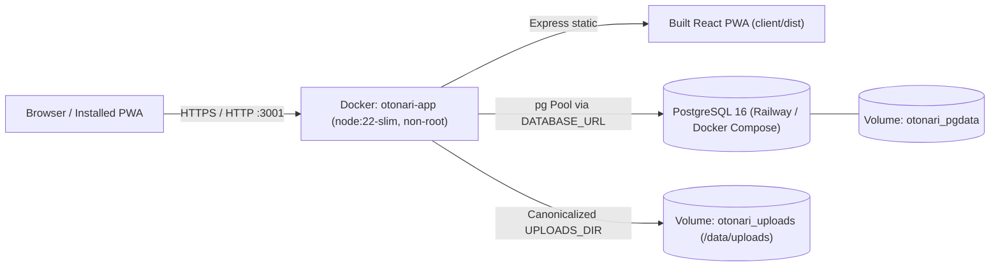

# Otonari v2 — Refactor, Infrastructure & Test Specification

This document defines the complete v2 engineering specification for **Otonari (お隣)**: migrating from SQLite + local disk to **PostgreSQL + Docker + Persistent Volumes**, hardening security boundaries, adding high-value UX features (exact date selection, lender polite ping, persistent sticky return-due banner, optional shelf item photos), and verifying all functionality with an automated test suite.

---

## 1. Hackathon Requirement Compliance

Aligned with `../Hackathon_Participant_Guide (2).pdf`:

| Requirement | Guide Constraint | Otonari v2 Compliance |
|---|---|---|
| Theme | **TSUNAGU — Update the Way We Connect** (working smartphone/web app) | Connects foreign residents & elderly Japanese neighbors through a working PWA (zero free-text, 4-language polite translation, digital *kairanban* QR poster). |
| Deadline | `Tue, Nov 24, 23:59 BST` (hard cutoff; repo snapshot at deadline) | All slices committed, tested, and verified on `v2` prior to deadline. |
| Evaluation points | Problem definition & theme fit, Technical skill, Completeness, Originality, Proposal clarity | Adds PostgreSQL, Docker + persistent volumes, server-side EXIF stripping, rate limiting, and `T01–T41` automated integration tests to strengthen Technical Skill and Completeness. |
| Repository rules | Public repo, no committed secrets, `.env` in `.gitignore`, repo matches proposal | Zero hardcoded credentials/secrets; `.env` gitignored; `README.md` & `CLAUDE.md` kept strictly synchronized with code. |
| AI disclosure (Rule #2) | State in proposal where and how AI tools were used | Documented transparently in `README.md` and `docs/SPEC.md`. |
| Submission artifacts | `[TeamName]_Proposal.pdf` (≤3 pages, English) + YouTube Unlisted video (≤3 min, English) | External deliverables tracked in team checklist outside code. |

---

## 2. Target Architecture: Docker + Persistent Volumes + PostgreSQL



### Persistence Guarantees
- **Local development (`npm run dev`):** `docker compose up -d db` provides PostgreSQL 16 on `localhost:5432` backed by `otonari_pgdata`; `UPLOADS_DIR` defaults to `server/uploads` (or any custom local folder in `server/.env`).
- **Local containerized (`docker compose up --build`):** Named volumes `otonari_pgdata` (`/var/lib/postgresql/data`) and `otonari_uploads` (`/data/uploads`) preserve all database rows and uploaded photos across restarts and rebuilds.
- **Railway deployment:** Managed Railway PostgreSQL injects `DATABASE_URL`; a Railway Volume mounted at `/data/uploads` with `UPLOADS_DIR=/data/uploads` persists uploaded images across restarts and redeploys. Auto-seeding runs only when `SELECT COUNT(*) FROM groups` is `0`.
- **Automated tests (`npm test`):** Isolated PostgreSQL test database (`DATABASE_URL`) and temporary directory (`fs.mkdtempSync`), cleaned up on teardown.

### Container & Deployment Artifacts
- `Dockerfile`: Multi-stage `node:22-slim` build (Stage 1 builds `client/dist`; Stage 2 installs server prod dependencies via `npm ci --omit=dev`, copies `server/` and `client/dist`, prepares `/data/uploads`, runs as non-root `node` user, exposes `3001`, `HEALTHCHECK` on `/api/health`).
- `.dockerignore`: Excludes `node_modules`, `client/dist`, `.git`, `.env`, `docs/`, `*.db*`, `server/uploads/*`.
- `docker-compose.yml`: `db` (`postgres:16-alpine` with `pg_isready` healthcheck + `otonari_pgdata`) and `app` (depends on healthy `db`, mounts `otonari_uploads:/data/uploads`).
- `railway.json`: `DOCKERFILE` builder, `healthcheckPath: "/api/health"`, `restartPolicyType: "ON_FAILURE"`.

---

## 3. PostgreSQL Schema & Module Contracts

Replaces `better-sqlite3` with pure-JS `pg` (`^8.13.0`) and removes `server/.npmrc`.

### 3.1 DDL (`server/db.js`)

```sql
CREATE TABLE IF NOT EXISTS groups (
  id SERIAL PRIMARY KEY,
  code TEXT UNIQUE NOT NULL,
  name TEXT NOT NULL,
  type TEXT NOT NULL CHECK (type IN ('building', 'block')),
  city TEXT NOT NULL
);

CREATE TABLE IF NOT EXISTS users (
  id SERIAL PRIMARY KEY,
  group_id INTEGER NOT NULL REFERENCES groups(id),
  nickname TEXT NOT NULL,
  lang TEXT NOT NULL CHECK (lang IN ('en', 'ja', 'ja-easy', 'bn')),
  elder_mode BOOLEAN NOT NULL DEFAULT FALSE,
  token TEXT UNIQUE NOT NULL,
  is_demo BOOLEAN NOT NULL DEFAULT FALSE,
  created_at TIMESTAMPTZ NOT NULL DEFAULT NOW(),
  left_at TIMESTAMPTZ
);

CREATE TABLE IF NOT EXISTS items (
  id SERIAL PRIMARY KEY,
  owner_id INTEGER NOT NULL REFERENCES users(id),
  group_id INTEGER NOT NULL REFERENCES groups(id),
  item_key TEXT NOT NULL,
  max_days INTEGER NOT NULL DEFAULT 3 CHECK (max_days IN (1, 2, 3, 7)),
  spot TEXT NOT NULL,
  trusted_only BOOLEAN NOT NULL DEFAULT FALSE,
  photo_url TEXT,
  status TEXT NOT NULL DEFAULT 'available' CHECK (status IN ('available', 'reserved', 'lent')),
  created_at TIMESTAMPTZ NOT NULL DEFAULT NOW(),
  removed_at TIMESTAMPTZ
);

CREATE TABLE IF NOT EXISTS loans (
  id SERIAL PRIMARY KEY,
  item_id INTEGER NOT NULL REFERENCES items(id),
  borrower_id INTEGER NOT NULL REFERENCES users(id),
  lender_id INTEGER NOT NULL REFERENCES users(id),
  start_at TIMESTAMPTZ NOT NULL,
  end_at TIMESTAMPTZ NOT NULL,
  status TEXT NOT NULL DEFAULT 'pending'
    CHECK (status IN ('pending', 'accepted', 'declined', 'cancelled', 'active', 'returned')),
  handover_photo TEXT,
  return_photo TEXT,
  returned_at TIMESTAMPTZ,
  reminded_soon_at TIMESTAMPTZ,
  reminded_overdue_at TIMESTAMPTZ,
  last_pinged_at TIMESTAMPTZ,
  created_at TIMESTAMPTZ NOT NULL DEFAULT NOW()
);

CREATE TABLE IF NOT EXISTS messages (
  id SERIAL PRIMARY KEY,
  loan_id INTEGER NOT NULL REFERENCES loans(id),
  from_user_id INTEGER REFERENCES users(id),
  to_user_id INTEGER NOT NULL REFERENCES users(id),
  phrase_key TEXT NOT NULL,
  params JSONB NOT NULL DEFAULT '{}'::jsonb,
  read_at TIMESTAMPTZ,
  created_at TIMESTAMPTZ NOT NULL DEFAULT NOW()
);

CREATE INDEX IF NOT EXISTS idx_items_group_active ON items(group_id) WHERE removed_at IS NULL;
CREATE INDEX IF NOT EXISTS idx_items_owner_active ON items(owner_id) WHERE removed_at IS NULL;
CREATE INDEX IF NOT EXISTS idx_loans_item_status ON loans(item_id, status);
CREATE INDEX IF NOT EXISTS idx_loans_borrower ON loans(borrower_id);
CREATE INDEX IF NOT EXISTS idx_loans_lender ON loans(lender_id);
CREATE INDEX IF NOT EXISTS idx_messages_loan ON messages(loan_id, created_at, id);
CREATE INDEX IF NOT EXISTS idx_messages_unread ON messages(to_user_id) WHERE read_at IS NULL;
```

### 3.2 Server Public Function Signatures

- **`server/db.js`**
  - `initDatabase(): Promise<void>` — creates tables/columns/indexes idempotently.
  - `resetDatabase(): Promise<void>` — drops and recreates tables for seeding/tests.
  - `closeDatabase(): Promise<void>` — drains pool cleanly.
  - `query(sql, params?, client?): Promise<pg.QueryResult>` — parameterized query runner.
  - `withTransaction(fn): Promise<T>` — checks out `PoolClient`, executes `BEGIN`/`COMMIT`/`ROLLBACK`, always calls `client.release()`.
  - `createMessage(loan, fromUserId, toUserId, phraseKey, client?): Promise<number>`
  - `findOpenLoan(itemId, borrowerId, client?): Promise<{ id: number } | undefined>`
  - `declinePendingLoans(itemId, exceptLoanId?, client?): Promise<void>`
  - `trustOf(userId, client?): Promise<{ joined_days: number, on_time: number, late: number }>`
  - `isTrusted(userId, client?): Promise<boolean>`
  - `publicUser(row): { id, group_id, nickname, lang, elder_mode }`
  - `getMe(userId, client?): Promise<{ user, group }>`
- **`server/photos.js`**
  - `getUploadsDir(): string` — canonicalized `path.resolve(process.env.UPLOADS_DIR || path.join(import.meta.dirname, 'uploads'))`, ensures directory exists via `fs.mkdirSync(..., { recursive: true })`.
  - `imageExtension(buffer): 'jpg' | 'png' | 'webp' | null` — magic-byte signature verification.
  - `stripJpegExif(buffer): Buffer` — removes APP1 (`0xFFE1`) EXIF/GPS metadata segments from JPEG payloads server-side.
  - `receivePhoto(req, res, next)` / `receiveOptionalPhoto(req, res, next)` — `multer.memoryStorage()`, 5 MB max, magic-byte check.
  - `savePhoto(file): Promise<string>` — strips EXIF if JPEG, writes UUID filename inside canonical `uploadsDir`, returns `/uploads/<uuid>.<ext>`.
  - `deletePhotoFile(photoUrl): Promise<void>` — validates canonical path boundary inside `uploadsDir`, deletes file (rollback helper).
  - `deletePhotos(): Promise<void>` — removes uploaded files while keeping `.gitkeep`.
  - `servePhoto(req, res)` — validates `/^[0-9a-f-]{36}\.(jpg|png|webp)$/`, enforces `resolved.startsWith(uploadsDir + path.sep)`, sets `X-Content-Type-Options: nosniff` and `Cache-Control: private, max-age=31536000`.
- **`server/rateLimit.js`**
  - `createRateLimiter({ windowMs, max, keyFn? }): express.RequestHandler` — in-memory fixed-window limiter returning `429` + `Retry-After` (can be disabled in non-rate-limit test runs via `DISABLE_RATE_LIMIT=true`).
- **`server/index.js`**
  - `createApp(): express.Express` — constructs Express app without binding port (enables clean integration tests).

---

## 4. API & Feature Contracts (v2 Additions & Changes)

| Endpoint | Auth | Request | Success | Errors |
|---|---|---|---|---|
| `GET /api/health` | Public | — | `200 { ok: true, db: 'ok', demo_mode: boolean }` | `503 { ok: false, db: 'error' }` |
| `POST /api/items` | `requireUser` | JSON or `multipart/form-data` (`item_key, max_days, spot, trusted_only?, photo?`) | `201` item with `photo_url` | `400`, `413` |
| `POST /api/loans` | `requireUser` | `{ item_id, start_at, end_at }` (`start_at` within `[-1h, +14d]`) | `201` loan details | `400`, `403`, `404`, `409` |
| `POST /api/loans/:id/cancel` | `participant` | — | `200` loan details (allowed on `pending`, OR `accepted` without `handover_photo`, resetting item to `available`) | `403`, `404`, `409` |
| `POST /api/loans/:id/ping` | `lender` | — | `200` loan details; sends `pingOverdue` if `now > end_at`, else `pingNeedBack`; records `last_pinged_at` | `403`, `404`, `409` (not active or return photo uploaded), `429 { error, retry_after_seconds }` (cooldown: 4h normal / 10s demo) |
| `GET /api/due-loans` | `requireUser` | — | `200` borrower's active loans with `return_photo IS NULL` and `end_at <= NOW() + 24h`, ordered `end_at ASC`, with `{ id, item_key, end_at, spot, lender_nickname, overdue }` | `401` |
| `POST /api/demo/fast-forward/:loanId` | `requireUser` + participant (`DEMO_MODE=true`) | `{ to: 'dueSoon' \| 'overdue' }` | `204` | `400`, `401`, `403`, `404`, `409` |
| `GET /uploads/:filename` | UUID allowlist | — | `200` image binary + `X-Content-Type-Options: nosniff` | `400`, `404` |

### Frontend v2 Changes
- **Sticky Return-Due Bar (`Banner.jsx`, `useInbox.js`):** Polls `/api/inbox` and `/api/due-loans` together every 5s, pauses when `document.visibilityState === 'hidden'`, refreshes immediately on tab focus. Renders a persistent top return-due / overdue bar with 🔊 read-aloud and one-tap **Return** button (hidden only on that specific `/loan/:id`).
- **Exact Date Picker (`ItemPage.jsx`):** Retains 1-tap `Today / Tomorrow / Day after` chips (with calendar dates) and adds a `Pick a date` (`<input type="date">`, today to +14 days JST) driving live lender-language preview.
- **Optional Shelf Item Photo (`MyItems.jsx`, `Shelf.jsx`, `ItemPage.jsx`):** Lenders can optionally attach a resized/EXIF-stripped photo when listing an item; shelf cards and item header show the photo thumbnail when present, falling back cleanly to the catalog emoji. Empty shelf shows a direct button to `/my-items`.
- **Lender Polite Ping & Cancel-Before-Handover (`LoanPage.jsx`):** Active loans (before return photo) show a polite ping button (`Ask to return soon` / `Send polite reminder`) with cooldown feedback; accepted loans (before handover photo) allow cancellation by either party. `DemoButtons` detects demo mode via `GET /api/health` (no 404 console spam).
- **4-Language Parity (`en`, `ja`, `ja-easy`, `bn`):** Merges `origin/asim-localization-verification` and adds full translations for all new v2 phrases and UI labels.

---

## 5. Security, Performance & Compatibility Constraints

- **Security:** Parameterized SQL exclusively; zero committed secrets; strict filename allowlist + `path.resolve` canonical boundary check on uploads; server-side JPEG EXIF/GPS stripping; security headers (`X-Content-Type-Options: nosniff`, `X-Frame-Options: DENY`, `Referrer-Policy: same-origin`); rate limiting on group lookup/creation, join, and quick replies; non-root container user.
- **Performance:** `pg.Pool` connection pooling (max 10); partial PostgreSQL indexes on active items & unread messages; single aggregated query for `GET /api/inbox` (eliminates N+1 `trustOf` calls); visibility-aware client polling.
- **Backward compatibility:** Preserves all existing routes, phrase-key message model, `ja-easy → ja → en` and `bn → en` fallbacks, and toggleable `DEMO_MODE`.

---

## 6. Incremental Vertical Slices

Each slice is independently implemented, reviewed, verified by automated tests, and committed on `v2` before beginning the next:

1. **Slice 0 — Branch, Localization Merge & Spec:** Create `v2`, merge `origin/asim-localization-verification`, commit `docs/refactor-plan.md`.
2. **Slice 1 — PostgreSQL Core (`db.js`, `auth.js`, `seed.js`, `reminders.js`) + DB/Reminder Tests:** Migrate storage layer to `pg`, remove `better-sqlite3` and `.npmrc`, verify `server/test/db-reminders.test.js` against PostgreSQL 16.
3. **Slice 2 — Persistent Volume Photos + Server-Side EXIF Stripping (`photos.js`) + Photo Tests:** Canonicalized `UPLOADS_DIR`, `stripJpegExif`, rollback delete, `servePhoto`, verify `server/test/photos.test.js`.
4. **Slice 3 — Async API Routes, Hardening, Ping, Exact Dates & Due-Loans + Full API Tests:** Migrate `groups.js`, `items.js`, `loans.js`, `inbox.js`, `demo.js`, `index.js`, add `rateLimit.js`, verify `server/test/api.test.js` (`T01–T38`).
5. **Slice 4 — Frontend v2 Upgrades & 4-Language i18n + Parity Tests:** Update React pages/components/CSS and all 4 i18n JSON files, add `server/test/i18n.test.js` (`T39`), verify `npm test && npm run build`.
6. **Slice 5 — Docker, Persistent Volumes & Railway Packaging + Container Persistence Test:** Add `Dockerfile`, `.dockerignore`, `docker-compose.yml`, `railway.json`; verify `docker compose up --build` and persistence of DB rows + uploaded photos across `docker compose restart app` (`T40–T41`).
7. **Slice 6 — Documentation Synchronization & Final Audit:** Update `README.md`, `CLAUDE.md`, `server/.env.example`; run final full test + build verification.

> **v3 Update:** Subsequent v3 upgrades (modular `server/` architecture, Building Manager auth & approval/moderation, Device Transfer & Lost-Phone Restore, 3-layer Notification Center + SSE + Web Push pipeline, OpenAPI 3.0.3 at `/api/docs`, and GitHub Actions CI) are specified in [docs/SPEC.md](SPEC.md).

---

## 7. Given/When/Then Test Matrix (`T01–T41`)

### Health & Security Headers
- **T01:** Given healthy PostgreSQL → When `GET /api/health` → Then `200 { ok: true, db: 'ok', demo_mode }` with `x-content-type-options: nosniff`, `x-frame-options: DENY`, `referrer-policy: same-origin`.
- **T02:** Given unknown `/api/does-not-exist` → When requested → Then JSON `404 { error: 'Not found' }`.

### Neighborhood Groups & Auth
- **T03:** Given valid `{ name, type: 'building', city }` → When `POST /api/groups` → Then `201` with unique `XXXX-XXXX` code excluding `I/L/O/0/1`.
- **T04:** Given existing group `"Sakura Heights"` in `"Nagasaki"` → When `POST /api/groups` with `"sakuraheights"` (or full-width NFKC equivalent) without `create_anyway` → Then `409 { existing_name }` and response contains no `code`; with `create_anyway: true` → `201`.
- **T05:** Given valid group code in lowercase → When `GET /api/groups/by-code/sakura-2611` → Then `200 { name, type, city, memberCount }`; unknown code → `404`.
- **T06:** Given valid code, 1–20 char nickname, valid `lang` → When `POST /api/join` → Then `201 { token, user, group }`.
- **T07:** Given empty/>20-char nickname, invalid `lang`, or unknown code → When `POST /api/join` → Then `400` or `404`.
- **T08:** Given valid Bearer token → When `GET /api/me` and `PATCH /api/me { lang: 'ja-easy', elder_mode: true }` → Then `200` with persisted updates.
- **T09:** Given missing or invalid Bearer token → When `GET /api/me` → Then `401`.

### Shelf, Catalog & Optional Item Photos
- **T10:** Given valid JSON `{ item_key, max_days, spot }` → When `POST /api/items` → Then `201` with `photo_url: null`; invalid key/duration/spot → `400`.
- **T11:** Given multipart `POST /api/items` with valid JPEG containing APP1 EXIF/GPS segment → When saved and fetched via `GET /uploads/:file` → Then `201` with `photo_url`, `GET` returns `200` JPEG with APP1 EXIF segment stripped and `x-content-type-options: nosniff`.
- **T12:** Given spoofed `.jpg` text upload → When `POST /api/items` or `/handover` → Then `400`; >5 MB payload → `413`.
- **T13:** Given two groups → When user in group A requests `GET /api/shelf` or group B's `GET /api/items/:id` → Then shelf contains only group A items and cross-group item returns `403`.
- **T14:** Given item owner vs. non-owner → When `PATCH /api/items/:id { trusted_only: true }` → Then owner gets `204`, non-owner gets `403`.
- **T15:** Given available item with pending loan → When owner `DELETE /api/items/:id` → Then `204`, item soft-deleted, pending loan auto-declined with `'decline'` message; deleting reserved/lent item → `409`.

### Borrow Flow, Exact Dates & Loan Lifecycle
- **T16:** Given available item → When `POST /api/loans` with exact start date `+5 days` and valid duration ≤ `max_days` → Then `201` pending loan + `'request'` message to lender.
- **T17:** Given start date >1h in past, >14d in future, or duration > `max_days` → When `POST /api/loans` → Then `400`.
- **T18:** Given own item, duplicate open loan by same borrower, or `trusted_only` item for untrusted user → When `POST /api/loans` → Then `403` / `409 { loan_id }` / `403`.
- **T19:** Given two pending requests on same item → When lender `POST /api/loans/:id/accept` → Then accepted loan becomes `accepted`, item becomes `reserved`, competing loan atomically becomes `declined` with `'decline'` message.
- **T20:** Given pending loan → When lender `POST /api/loans/:id/decline` with `default` or `busy` → Then `declined` with `'decline'` / `'declineBusy'`; invalid reason → `400`.
- **T21:** Given `pending` loan → When borrower `POST /api/loans/:id/cancel` → Then `cancelled` + `'cancel'` message.
- **T22:** Given `accepted` loan **without** `handover_photo` → When borrower or lender `POST /api/loans/:id/cancel` → Then loan becomes `cancelled`, item resets to `available`, other party receives `'cancel'` message; after `handover_photo` or when `active` → `409`.
- **T23:** Given `accepted` loan → When lender uploads valid image to `POST /api/loans/:id/handover` → Then `handover_photo` persisted + `'handoverPhoto'` message; duplicate upload → `409`; borrower attempting upload → `403`.
- **T24:** Given `accepted` loan with handover photo → When borrower `POST /api/loans/:id/received` → Then loan `active`, item `lent`; before handover photo → `409`.
- **T25:** Given `active` loan → When borrower uploads return photo (`POST /api/loans/:id/return`) and lender confirms (`POST /api/loans/:id/return-confirmed`) → Then `returned_at` recorded, loan `returned`, item `available`; on-time return (`returned_at <= end_at`) increments `on_time` and unlocks `trusted_only`; late return increments `late` without granting trust.

### Quick Replies, Reminders, Lender Polite Ping & Sticky Due-Loans
- **T26:** Given participant → When `POST /api/loans/:id/quick-reply` with allowed key → Then `200`; free text/unknown key → `400`; outsider → `403`.
- **T27:** Given active loan due in 12h (`return_photo IS NULL`) → When `checkReminders()` runs twice → Then `sys.dueSoon` sent exactly once; `GET /api/due-loans` includes loan with `overdue: false`.
- **T28:** Given active loan 1h overdue (`return_photo IS NULL`) → When `checkReminders()` runs twice → Then `sys.overdue` sent once to borrower and `sys.overdueLender` sent once to lender; `GET /api/due-loans` includes loan with `overdue: true`.
- **T29:** Given active loan after borrower uploads `return_photo` → When `checkReminders()` runs and borrower calls `GET /api/due-loans` → Then no reminder sent and loan excluded from `due-loans`.
- **T30:** Given active loan before `end_at` (`return_photo IS NULL`) → When lender calls `POST /api/loans/:id/ping` → Then `200` with `'pingNeedBack'` message; immediate second call within cooldown → `429 { retry_after_seconds }`.
- **T31:** Given overdue active loan after cooldown → When lender calls `POST /api/loans/:id/ping` → Then `200` with `'pingOverdue'` message; borrower calling `/ping` → `403`; calling after `return_photo` → `409`.

### Inbox, Demo Hardening, Safe Leaving, Path Traversal & Rate Limiting
- **T32:** Given unread messages for two users → When user A calls `GET /api/inbox` and `POST /api/inbox/read` with user B's message ID → Then user A sees only own messages and `updated: 0` for user B's ID.
- **T33:** Given `DEMO_MODE=true` and active loan → When unauthenticated calls `POST /api/demo/fast-forward/:id` → `401`; non-participant calls it → `403`; participant calls it → `204` and updates both `loans` dates and `messages.params` JSONB dates.
- **T34:** Given `DEMO_MODE=true` → When `POST /api/demo/login` with seeded demo user → `200`; with real joined user (`is_demo = false`) → `403`.
- **T35:** Given user with `accepted` or `active` loan → When `POST /api/leave` → `409`.
- **T36:** Given user with only `available` items and `pending` requests → When `POST /api/leave` → `204`, items soft-deleted, pending requests on own items declined, own pending requests cancelled, token invalidated (`401` on `/api/me`).
- **T37:** Given malicious upload path (`GET /uploads/..%2F..%2Fetc%2Fpasswd`, `GET /uploads/non-uuid.jpg`) → When requested → Then `400` or `404` without reading outside `UPLOADS_DIR`.
- **T38:** Given rate limiter enabled → When client exceeds threshold on `GET /api/groups/by-code/:code` → Then `429` with `Retry-After` header.

### Localization Parity & Container Persistence
- **T39:** Given `server/allowedKeys.js`, `client/src/data/catalog.js`, and `client/src/i18n/{en,ja,ja-easy,bn}.json` → When verified → Then all catalog/spot/quick-reply keys match identically and all phrases & required UI keys exist across all 4 languages without missing translations.
- **T40:** Given `docker compose up --build -d` → When `/api/health` is queried → Then `200 { ok: true, db: 'ok' }` and client SPA loads at `/`.
- **T41:** Given a new group, user, uploaded item photo, and loan created in the running Docker container → When `docker compose restart app` completes → Then group, item, loan, and `GET /uploads/:file` photo return `200` with identical bytes.
